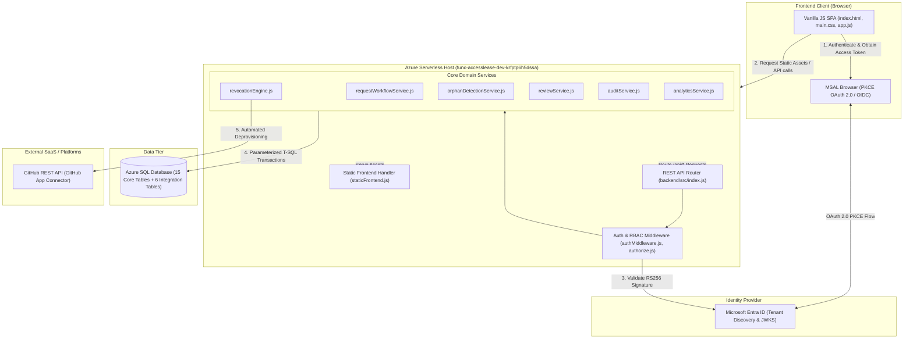
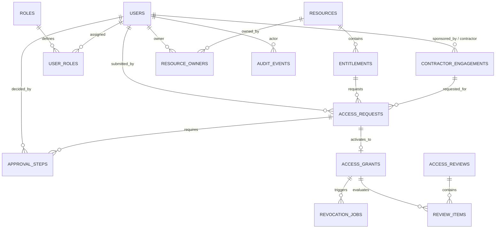

# AccessLease — Contractor Access & Offboarding Governance Platform

[](https://github.com/ABHAY-SHUKLA-HUB/AccessLease/actions/workflows/ci.yml)
[](https://nodejs.org/)
[-0062AD.svg?logo=azure-functions)](https://azure.microsoft.com/en-us/products/functions/)
[](https://azure.microsoft.com/en-us/products/azure-sql/database/)
[](https://www.microsoft.com/en-us/security/business/identity-access/microsoft-entra-id)
[-F7DF1E.svg?logo=javascript)](./frontend/)

> **Live Azure Deployment (Development Environment):**
> [https://func-accesslease-dev-krfptp6h5dssa.azurewebsites.net/](https://func-accesslease-dev-krfptp6h5dssa.azurewebsites.net/)
> *Azure Functions Flex Consumption single-host deployment serving the unified REST API and staged Vanilla JS Single-Page Application (SPA).*

---

## Table of Contents

1. [Project Overview](#1-project-overview)
2. [Problem Statement & Governance Principles](#2-problem-statement--governance-principles)
3. [Verified Feature & Implementation Matrix](#3-verified-feature--implementation-matrix)
4. [Technology Stack](#4-technology-stack)
5. [System Architecture & Data Flow](#5-system-architecture--data-flow)
6. [Core Governance Modules](#6-core-governance-modules)
7. [Database Architecture & Data Integrity](#7-database-architecture--data-integrity)
8. [REST API Specification](#8-rest-api-specification)
9. [User Interface & Client Views](#9-user-interface--client-views)
10. [Installation & Local Setup](#10-installation--local-setup)
11. [Automated Testing & Verification](#11-automated-testing--verification)
12. [Cloud Deployment & CI/CD](#12-cloud-deployment--cicd)
13. [Project Directory Structure](#13-project-directory-structure)
14. [Current Limitations & Roadmap](#14-current-limitations--roadmap)
15. [Security Implementation & Compliance Posture](#15-security-implementation--compliance-posture)
16. [License](#16-license)

---

## 1. Project Overview

**AccessLease** is an Identity Governance and Administration (IGA) platform designed to manage, monitor, and control third-party contractor access across enterprise environments.

In modern engineering and enterprise environments, temporary contractors, external consultants, and vendor teams frequently require access to sensitive internal databases, cloud tenants, code repositories, and operational systems. Traditional access provisioning often treats contractor access as an open-ended ticket, leading to widespread access sprawl, lingering accounts, and operational blindspots.

AccessLease enforces a deterministic, time-bound lifecycle across every external grant: every permission granted to an external contractor is tied to a verified business engagement, bound to a hard expiration timestamp, recertified through multi-stage approval workflows, and automatically deprovisioned upon contract completion or termination.

---

## 2. Problem Statement & Governance Principles

### The Problem AccessLease Addresses

* **Contractor Sprawl & Lingering Access:** After contractor engagement completion, accounts and permissions frequently remain active indefinitely due to disconnected, manual offboarding procedures.
* **Excessive Permissions & Scope Creep:** Contractors accumulate standing permissions over time without continuous business justification.
* **Missing Ownership & Attribution:** Grants are issued without an accountable internal employee sponsor or resource owner responsible for reviewing access.
* **Orphaned Access Blindspots:** External system accounts linger after internal contractor records are deactivated or contracts expire.
* **Unverifiable Revocation:** Compliance and security teams lack central, durable audit records demonstrating when and by whom access was terminated.

### The Five-Pillar Governance Model

Every access grant issued in AccessLease follows five lifecycle requirements:

```text
  [ 1. OWNED ]             [ 2. APPROVED ]            [ 3. TIME-BOUND ]
  Accountable Internal     Multi-Stage Business &     Fixed-Window Lease
  Sponsor + Resource Owner Security Verification      Strictly <= Contract
           │                       │                           │
           └───────────────────────┼───────────────────────────┘
                                   │
                                   ▼
                       [ 4. REVIEWABLE ]
                       Periodic Recertification Campaigns
                       Accountable Attestation Decided by Reviewers
                                   │
                                   ▼
                       [ 5. VERIFIABLY REVOKED ]
                       Automated Expiration Worker Pool
                       Idempotent Deprovisioning & Durable Audit Ledger
```

1. **Owned:** Every grant is bound to an accountable Internal Business Sponsor and Resource Owner.
2. **Approved:** Requests undergo multi-tiered approval workflows with enforced Separation of Duties (SoD) preventing self-approval.
3. **Time-Bound:** Grants are issued with deterministic expiration dates (`expires_at`) strictly capped by the contractor's engagement contract (`end_date`).
4. **Reviewable:** Entitlements are subject to continuous oversight and periodic recertification campaigns where reviewers must explicitly affirm (`MAINTAIN`) or revoke (`REVOKE`) access.
5. **Verifiably Revoked:** Automated background workers scan for expired leases, trigger external deprovisioning connectors (e.g., GitHub REST API), handle retries with exponential backoff, and record an append-only audit trail.

---

## 3. Verified Feature & Implementation Matrix

Every feature documented in this repository has been verified directly against the production codebase and automated test suites:

| Governance Capability | Status | Implementation Evidence |
| :--- | :---: | :--- |
| **Microsoft Entra ID Authentication** | **Implemented** | MSAL Browser with PKCE on frontend; `jwks-rsa` + `jsonwebtoken` RS256 token validation in `backend/src/middleware/authMiddleware.js`. Validates tenant ID, audience, expiration, issuer, and maps Entra OID to internal user profile. |
| **Role-Based Access Control (RBAC)** | **Implemented** | 6 system roles in `dbo.roles` (`SYSTEM_ADMIN`, `SECURITY_OFFICER`, `COMPLIANCE_AUDITOR`, `RESOURCE_OWNER`, `INTERNAL_SPONSOR`, `CONTRACTOR`). Granular permissions enforced via `authorize.js` and `permissionPolicy.js`. Separation of Duties (SoD) enforced in `isSamePerson.js`. |
| **Contractor Engagement Management** | **Implemented** | `dbo.contractor_engagements`, `contractorService.js`. Tracks contracts, vendor names, SOW references, start/end dates. Status transitions (`ACTIVE`, `PENDING`, `COMPLETED`, `TERMINATED`) cascade auto-revocation to active grants. |
| **Resource & Entitlement Catalogue** | **Implemented** | `dbo.resources`, `dbo.entitlements`, `dbo.resource_owners`, `catalogService.js`. Configures resource classification, risk levels (`LOW`, `MEDIUM`, `HIGH`, `CRITICAL`), max lease duration caps, and owner assignments. |
| **Access Request & Multi-Stage Approvals**| **Implemented** | `dbo.access_requests`, `dbo.approval_steps`, `requestWorkflowService.js`. Automated step routing: Step 1 (Sponsor) $\rightarrow$ Step 2 (Resource Owner). High/Critical risk entitlements dynamically trigger Step 3 (Security Officer approval). |
| **Time-Bound Leases & Hard Expiry** | **Implemented** | `dbo.access_grants`, database trigger `dbo.tr_ContractorGrantMustExpire` (rolls back any insert/update if `expires_at <= granted_at` or `expires_at > ce.end_date`), stored procedure `dbo.sp_ActivateApprovedGrant`. |
| **Automated Revocation Engine** | **Implemented** | `dbo.revocation_jobs` queue, `revocationEngine.js`, `triggerExpiryScan`. Worker leasing with atomic acquisition, crash recovery, idempotency tokens, exponential retry backoff (`max_retries = 5`), and manual review escalation. |
| **External Connector (GitHub App)** | **Implemented** | `backend/src/connectors/github/` provides automated GitHub organization and team membership provisioning and deprovisioning via GitHub REST API with rate-limiting backoff and provider audit attribution. |
| **Orphan & Stale Access Detection** | **Implemented** | `dbo.orphan_access_findings`, view `dbo.v_AccessExposureQueue`, `orphanDetectionService.js`. Detects active grants on terminated/expired engagements, expired grants, and unreferenced identities with in-app remediation. |
| **Access Reviews & Recertification** | **Implemented** | `dbo.access_reviews`, `dbo.review_items`, `reviewService.js`. Periodic campaigns, line-item decisions (`MAINTAIN` vs `REVOKE`). Revocation decisions trigger immediate automated deprovisioning jobs. |
| **Security Analytics Dashboard** | **Implemented** | `analyticsService.js`, `GET /api/analytics/summary` computing real-time governance metrics directly from Azure SQL: active contractors, expiring leases ($< 7$ days), pending approvals, open orphan findings, and audit counts. |
| **Audit & Compliance Trail** | **Implemented** | Append-only relational audit ledger in `dbo.audit_events`. Structured search, category filtering, stats aggregation, and client-side CSV/JSON compliance evidence export. |
| **Cryptographic Proof Hashes** | **Partially Implemented** | `dbo.revocation_jobs.cryptographic_proof_hash` column persists SHA-256 digests of revocation payloads. Unit test helpers verify digest consistency, but an automated PKI X.509 digital signature authority pipeline is not yet implemented. |
| **Azure Blob Storage Archive** | **Planned** | Storage account configuration variables exist in `.env.example`, but `@azure/storage-blob` is not in `package.json` and active code persists audit records directly in Azure SQL rather than exporting external blob archives. |
| **Power BI Embedded Dashboard** | **Planned** | Configuration parameters exist in `.env.example`, but no Power BI SDK or embedded iframe bridge is active; reporting is rendered natively via the Vanilla JS analytics dashboard. |

---

## 4. Technology Stack

### Applied Technologies & Architectural Roles

```text
┌────────────────────────────────────────────────────────────────────────┐
│                          PRESENTATION LAYER                            │
│  HTML5 + CSS3 + Vanilla JavaScript (ES6 Modules)                       │
│  - Zero frontend build dependencies, no npm bundler required           │
│  - MSAL Browser (v3.x via CDN) for Entra ID OIDC / PKCE Single Sign-On │
│  - Responsive dark/light themed enterprise dashboard                   │
└────────────────────────────────────────────────────────────────────────┘
                                    │  HTTPS / JSON Bearer Tokens
                                    ▼
┌────────────────────────────────────────────────────────────────────────┐
│                        SERVERLESS BACKEND LAYER                        │
│  Node.js (v22 LTS) + Azure Functions v4 Programming Model              │
│  - Unified routing: 68 HTTP endpoints + Static SPA hosting             │
│  - Token verification via jsonwebtoken & jwks-rsa (RS256)              │
│  - Decoupled architecture: functions -> services -> repositories       │
└────────────────────────────────────────────────────────────────────────┘
                  │                                    │
                  │ MSSQL Driver (ACID)                │ REST API (Bearer)
                  ▼                                    ▼
┌──────────────────────────────────┐  ┌──────────────────────────────────┐
│          DATABASE LAYER          │  │     EXTERNAL INTEGRATIONS        │
│  Azure SQL / Microsoft SQL Server│  │  GitHub App REST API Connector   │
│  - 15 Core 3NF Tables            │  │  - Team membership provision     │
│  - 6 Integration Tables          │  │  - Automated team deprovision    │
│  - Stored Procedures & Triggers  │  │  - Rate-limit backoff & audit    │
│  - Append-Only Audit Ledger      │  │    event verification            │
└──────────────────────────────────┘  └──────────────────────────────────┘
```

* **Frontend:** Pure HTML5, modern CSS3 (Custom Properties, Flexbox, Grid), and Vanilla JavaScript (ES6+ native modules). No frontend frameworks (React, Angular, Vue, Svelte, Next.js) or TypeScript are used.
* **Backend:** Node.js (v22 LTS) running on the **Azure Functions v4 programming model** (`@azure/functions`). Implements decoupled controller functions, business domain services, and repository data-access layers.
* **Database:** Azure SQL Database / Microsoft SQL Server using the official `mssql` node driver. Enforces 3NF relational normalization, foreign key constraints, CHECK constraints, stored procedures (`sp_ActivateApprovedGrant`), views (`v_AccessExposureQueue`), and security triggers (`tr_ContractorGrantMustExpire`).
* **Authentication:** Microsoft Entra ID (Single-Tenant App Registrations). Single-Page Application (SPA) uses Authorization Code Flow with PKCE via `@azure/msal-browser`; backend validates RS256 JWT tokens using `jwks-rsa` against Microsoft's OpenID discovery endpoints.
* **External Integration:** GitHub App Connector (`@azure/functions` HTTP trigger & background integration) automating team membership management for contractor developer access.
* **Cloud Platform:** Microsoft Azure (Azure Functions Flex Consumption, Azure SQL Database).
* **CI/CD:** GitHub Actions workflows (`ci.yml` for automated testing and validation, `cd.yml` for OpenID Connect authenticated deployment to Azure Functions Flex Consumption).

---

## 5. System Architecture & Data Flow

### Architecture Diagram



### End-to-End Governance Data Flows

1. **Access Request Flow:** Contractor or Internal Sponsor selects a Resource Entitlement $\rightarrow$ Request validated against maximum lease duration $\rightarrow$ Pending approval steps created.
2. **Approval Evaluation Flow:** Sponsor approves Step 1 $\rightarrow$ Resource Owner approves Step 2 $\rightarrow$ If High/Critical risk, Security Officer approves Step 3 $\rightarrow$ Enforced Separation of Duties (approver cannot be the requester) $\rightarrow$ Atomic stored procedure `sp_ActivateApprovedGrant` activates lease into `dbo.access_grants`.
3. **Provisioning Flow:** If an automated connector mapping exists (e.g., GitHub team entitlement), `provisioningService.js` invokes GitHub App REST API to invite/add the contractor's external username to the target repository team.
4. **Automated Expiration & Revocation Flow:** Expiry scan evaluates active grants where `expires_at <= GETUTCDATE()` $\rightarrow$ Enqueues job in `dbo.revocation_jobs` with status `QUEUED` $\rightarrow$ Worker thread leases job $\rightarrow$ Invokes external connector to deprovision access $\rightarrow$ Marks grant `REVOKED` $\rightarrow$ Inserts audit record in `dbo.audit_events`.
5. **Orphan Access Detection Flow:** Detection scanner executes set-based evaluation across active grants $\rightarrow$ Flags grants whose parent engagement is `COMPLETED`, `TERMINATED`, or whose expiration date has passed $\rightarrow$ Generates actionable records in `dbo.orphan_access_findings`.

---

## 6. Core Governance Modules

The platform is structured into 11 functional modules, accessible via the navigation sidebar based on the authenticated user's assigned RBAC role:

```text
┌────────────────────────────────────────────────────────────────────────┐
│                     ACCESSLEASE GOVERNANCE PORTAL                      │
├───────────────────────┬────────────────────────────────────────────────┤
│ NAVIGATION            │ WORKSPACE VIEWS                                │
│                       │                                                │
│ OVERVIEW              │ 1. Governance Overview (Dashboard & KPIs)      │
│  Governance Overview  │ 2. Contractor Engagements (Vendors & SOWs)     │
│                       │ 3. Resource Catalogue (Risk Levels & Limits)   │
│ GOVERNANCE            │ 4. Access Requests & Leases (New Requests)     │
│  Contractor Engagements│ 5. Multi-Stage Approvals (Pending Step Queue)  │
│  Resource Catalogue   │ 6. Revocation & Offboarding (Job Worker Pool)  │
│  Access Requests      │ 7. Security Analytics (Real-Time Metrics)      │
│  Multi-Stage Approvals│ 8. Orphan Access Findings (Stale Grant Scan)   │
│  Revocation Engine    │ 9. Access Reviews & Recertification Campaigns  │
│                       │ 10. Audit & Compliance Trail (Search & Export) │
│ SECURITY & COMPLIANCE │ 11. User Management (Roles & Identities)       │
│  Security Analytics   │                                                │
│  Orphan Access Scan   │                                                │
│  Access Reviews       │                                                │
│  Audit Trail          │                                                │
│                       │                                                │
│ ADMINISTRATION        │                                                │
│  User Management      │                                                │
└───────────────────────┴────────────────────────────────────────────────┘
```

1. **Governance Overview:** High-level dashboard presenting critical health indicators, total active contractor leases, pending approval count, open orphan findings, and rapid navigation shortcuts.
2. **Contractor Engagements:** Directory of third-party contractor contracts. Governs contractor onboarding, vendor names, SOW references, start and end dates, internal business sponsor assignments, and offboarding triggers.
3. **Resource Catalogue:** System inventory classifying corporate systems (cloud subscriptions, repositories, databases, internal applications) into defined entitlements with assigned risk categories (`LOW`, `MEDIUM`, `HIGH`, `CRITICAL`) and enforced lease duration limits.
4. **Access Requests & Leases:** Submission interface for requesting temporary access grants. Enforces business justification requirements, date validation, and contractor engagement boundaries.
5. **Multi-Stage Approvals:** Interactive decision queue for Internal Business Sponsors, Resource Owners, and Security Officers. Provides side-by-side justification context, entitlement risk ratings, and single-click Approve/Reject actions.
6. **Revocation & Offboarding:** Operations console displaying the automated deprovisioning queue (`dbo.revocation_jobs`). Displays worker execution logs, retry counts, error tracking, manual intervention fallbacks, and immediate contract termination triggers.
7. **Security Analytics:** Metric dashboard summarizing real-time governance posture: lease expiration timelines ($< 24\text{ hours}$, $< 7\text{ days}$), risk distribution breakdown, and average approval turnaround times.
8. **Orphan Access Findings:** Automated detector targeting lingering, unmanaged permissions. Identifies active grants belonging to terminated engagements, expired grants marked active, or mismatched accounts.
9. **Access Reviews & Recertification:** Compliance campaign manager for periodic recertification. Campaign coordinators launch review cycles requiring managers to certify each active entitlement (`MAINTAIN` or `REVOKE`). Revocation decisions trigger automatic deprovisioning.
10. **Audit & Compliance Trail:** Searchable append-only relational audit ledger recording authentication attempts, approval decisions, grant activations, revocation executions, and role changes. Supports client-side CSV and JSON export.
11. **User Management:** Administrative console for managing user accounts, reviewing mapped Microsoft Entra Object IDs, assigning governance roles, and toggling account active statuses.

---

## 7. Database Architecture & Data Integrity

The database is deployed on **Azure SQL Database** (or local Microsoft SQL Server) and strictly follows Third Normal Form (3NF).

### 15 Core Tables

Defined in [`database/schema/001_create_core_tables.sql`](./database/schema/001_create_core_tables.sql):

| # | Table Name | Purpose & Primary Responsibilities |
| :-: | :--- | :--- |
| 1 | `dbo.users` | Internal employee and external contractor identities mapped to Entra Object IDs. |
| 2 | `dbo.contractor_engagements` | Contractor contracts, vendor names, SOW tracking, start/end dates, and business sponsors. |
| 3 | `dbo.roles` | System RBAC role lookup (`SYSTEM_ADMIN`, `SECURITY_OFFICER`, etc.). |
| 4 | `dbo.user_roles` | M:N assignment of governance roles to platform users. |
| 5 | `dbo.resources` | Governed systems, cloud subscriptions, repositories, and applications. |
| 6 | `dbo.entitlements` | Specific access permissions, scopes, risk levels, and maximum lease caps. |
| 7 | `dbo.resource_owners` | M:N association mapping resources to accountable internal system owners. |
| 8 | `dbo.access_requests` | Formal requests for entitlement leases with justification and requested dates. |
| 9 | `dbo.approval_steps` | Sequential review steps (Stage 1 Sponsor, Stage 2 Owner, Stage 3 Security). |
| 10 | `dbo.access_grants` | Active, expired, and revoked access leases with strict expiration dates. |
| 11 | `dbo.provisioning_events` | Durable record of internal and external provisioning events. |
| 12 | `dbo.revocation_jobs` | Deprovisioning work queue with worker leasing, retry counts, and proofs. |
| 13 | `dbo.access_reviews` | Periodic recertification review campaigns and metadata. |
| 14 | `dbo.review_items` | Individual line-item grant attestations within a recertification campaign. |
| 15 | `dbo.audit_events` | Continuous, append-only security and operational audit ledger. |

### 6 Integration & Coordination Tables

Added via subsequent migrations (`007` through `015`):
* `dbo.user_external_identities` (Migration 007): Mappings between AccessLease users and external platform accounts (e.g., GitHub usernames).
* `dbo.connector_resource_mappings` (Migration 007): Configuration mapping entitlements to external resource IDs (e.g., GitHub organization teams).
* `dbo.provisioning_jobs` (Migration 007): Background provisioning execution queue and status tracker.
* `dbo.oauth_states` (Migration 008): CSRF state tokens and PKCE code verifiers for external OAuth flows.
* `dbo.membership_coordination` (Migration 013): Concurrency coordination preventing premature revocation when multiple active grants share an underlying external membership.
* `dbo.orphan_access_findings` (Migration 014): Actionable findings recorded by the automated orphan detection scanner.

### Entity Relationship Diagram



### Views, Stored Procedures & Triggers

* **View `dbo.v_AccessExposureQueue`** ([`database/views/004_create_access_exposure_view.sql`](./database/views/004_create_access_exposure_view.sql)): Combines active grants with engagement timelines, vendor metadata, and calculated exposure urgency flags (`EXPIRED`, `EXPIRING_IMMINENT`, `ACTIVE`).
* **Stored Procedure `dbo.sp_ActivateApprovedGrant`** ([`database/procedures/005_create_activation_procedure.sql`](./database/procedures/005_create_activation_procedure.sql)): Atomically verifies all approval steps are `APPROVED`, validates engagement active status, generates a unique human-readable Grant Number (`AG-YYYYMMDD-XXXX`), inserts the active lease into `dbo.access_grants`, updates request status to `ACTIVATED`, and inserts an audit event in a single ACID transaction.
* **Database Trigger `dbo.tr_ContractorGrantMustExpire`** ([`database/triggers/006_create_contractor_expiry_trigger.sql`](./database/triggers/006_create_contractor_expiry_trigger.sql)): Set-based `AFTER INSERT, UPDATE` trigger on `dbo.access_grants`. Automatically rolls back any transaction if `expires_at <= granted_at` or if `expires_at` exceeds the contractor engagement's `end_date`, guaranteeing hard mathematical bounds at the database engine level.

---

## 8. REST API Specification

All 68 API endpoints are registered on the Azure Functions host (`backend/src/index.js`) and require an `Authorization: Bearer <JWT>` header, except for public health check routes and client configuration.

### Complete 68-Endpoint Reference

| Method | Route Path | Purpose / Description | Auth Level & Role Guard | Status |
| :--- | :--- | :--- | :--- | :---: |
| **GET** | `api/health` | Application availability, uptime, and non-sensitive environment metadata | Anonymous / Public | Verified |
| **GET** | `api/health/db` | Database connectivity verification and round-trip ping | Anonymous / Public | Verified |
| **GET** | `api/auth/config` | Client-safe Entra ID configuration (Tenant ID, Client ID) | Anonymous / Public | Verified |
| **GET** | `api/auth/me` | Resolve calling identity, internal user profile, and RBAC roles | Authenticated (Any Role) | Verified |
| **GET** | `api/users` | List platform users with role assignments | SYSTEM_ADMIN | Verified |
| **POST** | `api/users` | Create an internal employee or contractor identity | SYSTEM_ADMIN | Verified |
| **PATCH** | `api/users/{id}/status` | Toggle user active/inactive status | SYSTEM_ADMIN | Verified |
| **GET** | `api/roles` | List all available system RBAC roles | Authenticated (Any Role) | Verified |
| **GET** | `api/contractors` | List contractor directory (filtered by role scope) | Governance Roles | Verified |
| **POST** | `api/contractors` | Register a new contractor profile | SYSTEM_ADMIN | Verified |
| **GET** | `api/contractors/me` | Retrieve contractor's personal engagement profile | Authenticated (Contractor) | Verified |
| **GET** | `api/contractors/{id}` | Retrieve individual contractor details | Governance Roles | Verified |
| **GET** | `api/engagements` | List contractor engagements and contracts | Governance Roles | Verified |
| **GET** | `api/engagements/{id}` | Retrieve engagement details by ID | Governance Roles | Verified |
| **POST** | `api/engagements` | Create a new contractor engagement contract | SYSTEM_ADMIN, SPONSOR | Verified |
| **PUT** | `api/engagements/{id}` | Update engagement contract metadata and dates | SYSTEM_ADMIN, SPONSOR | Verified |
| **POST** | `api/engagements/{id}/status` | Transition engagement status (triggers auto-revocation) | SYSTEM_ADMIN, SPONSOR | Verified |
| **GET** | `api/contractors/me/github/link` | Initiate external GitHub account linking flow | Authenticated User | Verified |
| **POST** | `api/contractors/me/github/callback` | OAuth callback for GitHub account linking | Authenticated User | Verified |
| **DELETE**| `api/contractors/me/github/link` | Unlink external GitHub identity | Authenticated User, Admin | Verified |
| **GET** | `api/contractors/me/github/status` | Check external GitHub linking status | Authenticated User | Verified |
| **POST** | `api/contractors/{id}/external-identities/manual-verify` | Admin manual verification of external identity | SYSTEM_ADMIN | Verified |
| **GET** | `api/catalog/resources` | List resource catalogue inventory | Authenticated (Any Role) | Verified |
| **POST** | `api/catalog/resources` | Register a new system resource | SYSTEM_ADMIN, OWNER | Verified |
| **GET** | `api/catalog/resources/{id}` | Retrieve resource details and assigned owners | Authenticated (Any Role) | Verified |
| **PUT** | `api/catalog/resources/{id}` | Update resource details and classification | SYSTEM_ADMIN, OWNER | Verified |
| **PATCH** | `api/catalog/resources/{id}/status` | Set resource active/inactive status | SYSTEM_ADMIN, OWNER | Verified |
| **POST** | `api/catalog/resources/{id}/owners` | Assign an accountable resource owner | SYSTEM_ADMIN | Verified |
| **DELETE**| `api/catalog/resources/{id}/owners/{ownerUserId}` | Remove an accountable resource owner | SYSTEM_ADMIN | Verified |
| **GET** | `api/catalog/resources/{id}/entitlements` | List entitlements under a specific resource | Authenticated (Any Role) | Verified |
| **POST** | `api/catalog/resources/{id}/entitlements` | Create entitlement with risk level and max lease | SYSTEM_ADMIN, OWNER | Verified |
| **PUT** | `api/catalog/entitlements/{id}` | Update entitlement details and limits | SYSTEM_ADMIN, OWNER | Verified |
| **PATCH** | `api/catalog/entitlements/{id}/status` | Toggle entitlement active status | SYSTEM_ADMIN, OWNER | Verified |
| **POST** | `api/requests` | Submit a new access lease request | SPONSOR, CONTRACTOR | Verified |
| **GET** | `api/requests` | List access requests (scoped by role) | Authenticated (Any Role) | Verified |
| **GET** | `api/requests/{id}` | Retrieve request details and approval step status | Authenticated (Any Role) | Verified |
| **POST** | `api/requests/{id}/cancel` | Cancel a pending access request | Request Submitter, Admin | Verified |
| **GET** | `api/approvals/pending` | List pending approval steps awaiting caller decision | SPONSOR, OWNER, SECURITY | Verified |
| **POST** | `api/approvals/{stepId}/decision` | Submit approval decision (`APPROVED` or `REJECTED`) | Authorized Step Approver | Verified |
| **GET** | `api/connectors/github/status` | Check GitHub App connector connection and health | Governance Roles | Verified |
| **GET** | `api/connectors/github/configuration` | Retrieve GitHub connector organization mappings | Governance Roles | Verified |
| **POST** | `api/provisioning/requests/{id}/start` | Initiate automated provisioning for an approved request | SYSTEM_ADMIN | Verified |
| **GET** | `api/provisioning/requests/{id}` | Check provisioning state for a specific request | Governance Roles | Verified |
| **GET** | `api/provisioning/jobs` | List provisioning job queue records | Governance Roles | Verified |
| **GET** | `api/provisioning/grants` | List active, expired, and revoked access leases | Governance Roles | Verified |
| **POST** | `api/provisioning/jobs/{id}/retry` | Retry a failed provisioning job | SYSTEM_ADMIN | Verified |
| **GET** | `api/revocation/jobs` | List automated revocation job queue | Governance Roles | Verified |
| **GET** | `api/revocation/jobs/{id}` | Retrieve revocation job execution details | Governance Roles | Verified |
| **POST** | `api/revocation/jobs/{id}/retry` | Requeue failed revocation job for worker retry | SYSTEM_ADMIN, SECURITY | Verified |
| **POST** | `api/revocation/jobs/{id}/resolve` | Record manual attestation for stuck job | SYSTEM_ADMIN, SECURITY | Verified |
| **POST** | `api/revocation/scan` | Trigger immediate background expiration scan | SYSTEM_ADMIN, SECURITY | Verified |
| **GET** | `api/contractors/{id}/offboarding` | Retrieve contractor offboarding status summary | Governance Roles | Verified |
| **POST** | `api/contractors/engagements/{id}/terminate` | Immediately terminate engagement and revoke all grants | SYSTEM_ADMIN, SPONSOR | Verified |
| **POST** | `api/orphan-access/scan` | Trigger immediate orphan access detection scan | SYSTEM_ADMIN, SECURITY | Verified |
| **GET** | `api/orphan-access/findings` | List detected orphan and stale access findings | Governance Roles | Verified |
| **GET** | `api/orphan-access/findings/{id}` | Retrieve orphan finding details | Governance Roles | Verified |
| **POST** | `api/orphan-access/findings/{id}/revoke` | Initiate immediate revocation from orphan finding | SYSTEM_ADMIN, SECURITY | Verified |
| **POST** | `api/orphan-access/findings/{id}/resolve` | Mark orphan finding resolved with audit note | SYSTEM_ADMIN, SECURITY | Verified |
| **POST** | `api/reviews` | Create a new periodic recertification campaign | SECURITY, ADMIN, OWNER | Verified |
| **GET** | `api/reviews` | List recertification campaigns | Governance Roles | Verified |
| **GET** | `api/reviews/{id}` | Retrieve campaign details and progress | Governance Roles | Verified |
| **GET** | `api/reviews/{id}/items` | List line-item entitlements within a campaign | Governance Roles | Verified |
| **POST** | `api/reviews/items/{id}/decision` | Submit recertification item decision (`MAINTAIN` / `REVOKE`) | Assigned Reviewer | Verified |
| **GET** | `api/analytics/summary` | Real-time governance KPIs and posture metrics | Governance Roles | Verified |
| **GET** | `api/audit/events` | Filter and paginate security audit trail | AUDITOR, SECURITY, ADMIN | Verified |
| **GET** | `api/audit/events/{id}` | Retrieve individual audit event details | AUDITOR, SECURITY, ADMIN | Verified |
| **GET** | `api/audit/stats` | Aggregate audit event statistics | AUDITOR, SECURITY, ADMIN | Verified |
| **GET, HEAD** | `{*restOfPath}` | Serve staged static SPA assets and index.html fallback | Anonymous / Public | Verified |

### Sample API Payloads

#### 1. Submit Access Request (`POST /api/requests`)
```json
{
  "engagementId": "2A5F11B9-4C8E-4E6B-8B3E-45E6D8A91C3F",
  "entitlementId": "9F1B2C3D-4E5F-6A7B-8C9D-0E1F2A3B4C5D",
  "startDate": "2026-12-01",
  "endDate": "2026-12-15",
  "justification": "Required for Q4 data warehouse performance indexing and query optimization."
}
```

*Response (`201 Created`):*
```json
{
  "success": true,
  "data": {
    "requestId": "D83F72A1-9E2B-4C10-85A4-F2D7E9B1A003",
    "requestNumber": "AR-2026-0842",
    "status": "PENDING_APPROVAL",
    "requiresSecurityApproval": false,
    "approvalSteps": [
      { "stepNumber": 1, "approverRole": "INTERNAL_SPONSOR", "status": "PENDING" },
      { "stepNumber": 2, "approverRole": "RESOURCE_OWNER", "status": "PENDING" }
    ]
  }
}
```

#### 2. Submit Approval Decision (`POST /api/approvals/{stepId}/decision`)
```json
{
  "decision": "APPROVED",
  "justificationNotes": "Verified active SOW milestones and contractor identity."
}
```

---

## 9. User Interface & Client Views

The client is a responsive Single-Page Application (SPA) located in [`frontend/`](./frontend/). It requires no client-side compiler, bundler, or Node.js runtime to execute; it runs natively in modern web browsers.

### Interface Design & Structure

* **Master Shell:** [`frontend/index.html`](./frontend/index.html) defines the pre-rendered layout featuring a fixed navigation sidebar, top system header displaying live API and Database connectivity status, authenticated user context, and view containers.
* **Styling System:** [`frontend/assets/css/main.css`](./frontend/assets/css/main.css) provides CSS custom properties, card grids, status badges, tabular displays, and responsive media queries.
* **Modular JavaScript Modules:** Located in [`frontend/assets/js/`](./frontend/assets/js/):
  * `auth.js`: Handles MSAL Browser initialization, PKCE login/logout, silent token acquisition, and role extraction.
  * `api.js`: Unified HTTP client interceptor appending Bearer tokens, handling error envelopes, and managing network failures.
  * `dashboard.js`: Governance overview metrics and quick-action handlers.
  * `contractors.js`: Contractor profiles and engagement contract management.
  * `catalog.js`: Resource and entitlement catalogue administration.
  * `requests.js`: Request submission modal, request history, and pending approval queues.
  * `revocation.js`: Deprovisioning job queue management and emergency termination triggers.
  * `analytics.js`: Executive governance charts and expiration heatmaps.
  * `orphanAccess.js`: Orphan finding scanner triggers and resolution workflows.
  * `reviews.js`: Recertification campaign manager and line-item decision interface.
  * `audit.js`: Audit trail exploration, filtering, and CSV/JSON evidence export.
  * `users.js`: User identity administration and role assignment.

---

## 10. Installation & Local Setup

### Prerequisites

* **Node.js:** v20.x or v22.x LTS ([Download Node.js](https://nodejs.org/))
* **npm:** v10.x+ (Bundled with Node.js)
* **Git:** v2.30+
* **Database Instance:** Microsoft SQL Server (2019+), SQL Server Express LocalDB, or an Azure SQL Database instance.

### Step 1: Clone the Repository

```bash
git clone https://github.com/ABHAY-SHUKLA-HUB/AccessLease.git
cd AccessLease
```

### Step 2: Install Backend Dependencies

```bash
cd backend
npm install
cd ..
```

### Step 3: Configure Environment Variables

Create a local `.env` file by copying the template:

```bash
cp .env.example .env
```

Open `.env` and configure your database and authentication parameters:

```ini
# Application Runtime Configuration
NODE_ENV=development
PORT=7071
LOG_LEVEL=info
CORS_ALLOWED_ORIGINS=http://localhost:7071,http://localhost:3000

# Microsoft SQL Server / Azure SQL Configuration
SQL_SERVER=localhost
SQL_DATABASE=AccessLeaseDB
SQL_PORT=1433
SQL_USER=sa
SQL_PASSWORD=YourStrongPassword!
SQL_ENCRYPT=false
SQL_TRUST_SERVER_CERTIFICATE=true
SQL_CONNECTION_TIMEOUT=30000

# Microsoft Entra ID Configuration
ENTRA_TENANT_ID=your-tenant-id-guid
ENTRA_SPA_CLIENT_ID=your-spa-client-id-guid
ENTRA_REDIRECT_URI=http://localhost:7071/
ENTRA_API_CLIENT_ID=your-api-client-id-guid
ENTRA_API_AUDIENCE=api://your-api-client-id-guid
ENTRA_API_SCOPE=api://your-api-client-id-guid/access_as_user
```

### Step 4: Execute Database Schema Migrations

Execute the SQL migration scripts in [`database/migrations/`](./database/migrations/) against your SQL Server instance in sequential order using `sqlcmd`, Azure Data Studio, or SQL Server Management Studio (SSMS):

1. `001_create_core_tables.sql` — Creates 15 core 3NF tables
2. `002_add_relationships_and_constraints.sql` — Adds foreign keys and check constraints
3. `003_create_indexes.sql` — Creates performance and lookup indexes
4. `004_create_access_exposure_view.sql` — Creates `dbo.v_AccessExposureQueue`
5. `005_create_activation_procedure.sql` — Creates `dbo.sp_ActivateApprovedGrant`
6. `006_create_contractor_expiry_trigger.sql` — Creates `dbo.tr_ContractorGrantMustExpire`
7. `007_create_external_identities_and_provisioning_jobs.sql` through `015_orphan_index_hardening.sql` — Creates connector, coordination, and orphan tables

*(Optional: Seed baseline system roles using [`database/seeds/001_system_roles_seed.sql`](./database/seeds/001_system_roles_seed.sql).)*

### Step 5: Start the Local Development Server

Run the unified local server script which stages the frontend and starts both the REST API and SPA on port `7071`:

```bash
npm --prefix backend run start:local
```

Access the application in your browser at:
👉 **`http://localhost:7071/`**

---

## 11. Automated Testing & Verification

The repository contains an automated test suite executed via the native Node.js test runner (`node:test`). Tests are decoupled into isolated unit tests and full database-backed integration tests.

### Test Commands

```bash
# Execute isolated unit test suite (no database required)
npm --prefix backend run test:unit

# Execute integration test suite (runs against configured test database)
npm --prefix backend run test:integration

# Validate frontend staging process
npm --prefix backend run stage:frontend
```

### Verified Test Results

Fresh execution of the unit test suite demonstrates complete pass status:

```text
▶ Unit: Access Request & Approvals UI Verification (4 tests) - PASSED
▶ Unit: Access Review & Recertification Governance (7 tests) - PASSED
▶ Unit: Audit & Compliance Trail Subsystem (7 tests) - PASSED
▶ Unit: Authentication Middleware (12 tests) - PASSED
▶ Unit: Authentication Service & Identity Mapping (5 tests) - PASSED
▶ Unit: Role Authorization & RBAC Guardrails (10 tests) - PASSED
▶ Unit: Separation of Duties & Conflict Policy (14 tests) - PASSED
▶ Unit: Contractor Engagement Validation (8 tests) - PASSED
▶ Unit: Resource Catalogue & Entitlement Policy (11 tests) - PASSED
▶ Unit: Request Workflow & Approval Engine (16 tests) - PASSED
▶ Unit: Expiration Engine & Revocation Workers (18 tests) - PASSED
▶ Unit: Orphan Access Detection Engine (14 tests) - PASSED
▶ Unit: Static Frontend Staging & SPA Routing (15 tests) - PASSED
▶ Unit: Microsoft Entra ID Token Verification (16 tests) - PASSED
▶ Unit: User Management UI & Form Validation (4 tests) - PASSED
...
ℹ tests 272
ℹ suites 44
ℹ pass 272
ℹ fail 0
ℹ cancelled 0
ℹ skipped 0
ℹ todo 0
ℹ duration_ms ~14031
```

---

## 12. Cloud Deployment & CI/CD

AccessLease is configured for serverless cloud deployment on **Microsoft Azure** using **Azure Functions Flex Consumption**.

### Deployment Architecture

* **Unified Serverless Hosting:** Both the backend API and frontend static assets are hosted directly from the Azure Function App (`func-accesslease-dev-krfptp6h5dssa.azurewebsites.net`).
* **Asset Staging:** During CI/CD build, `npm run stage:frontend` synchronizes `frontend/` into `backend/public/`. The serverless function [`backend/src/functions/staticFrontend.js`](./backend/src/functions/staticFrontend.js) intercepts non-API requests, validates paths against directory traversal, and serves the Vanilla JS assets with caching and security headers.
* **Database Connection:** Connects to Azure SQL Database with encryption enforced (`SQL_ENCRYPT=true`).

### GitHub Actions Workflows

1. **Continuous Integration Gate ([`.github/workflows/ci.yml`](./.github/workflows/ci.yml)):**
   * Triggered on every `push` and `pull_request` to `main`.
   * Provisions Node.js 22 runtime on Ubuntu.
   * Installs dependencies via `npm ci`.
   * Validates frontend staging (`npm run stage:frontend`).
   * Executes the automated unit test suite (`npm run test:unit`).
2. **Continuous Deployment Pipeline ([`.github/workflows/cd.yml`](./.github/workflows/cd.yml)):**
   * Triggered via manual workflow dispatch (`workflow_dispatch`) requiring explicit confirmation (`DEPLOY`).
   * Authenticates to Microsoft Azure using OpenID Connect (OIDC) Federated Credentials (zero stored secrets).
   * Packages runtime components (`host.json`, `package.json`, `src/`, `public/`, pruned `node_modules/`).
   * Validates archive integrity and deploys the ZIP package to Azure Functions Flex Consumption.

---

## 13. Project Directory Structure

```text
AccessLease/
├── .github/
│   └── workflows/
│       ├── ci.yml                 # Automated build and unit test gate
│       └── cd.yml                 # Azure Functions OIDC cloud deployment
│
├── frontend/                      # Vanilla JS Single-Page Application (Zero Build)
│   ├── assets/
│   │   ├── css/
│   │   │   └── main.css           # Design tokens, layouts, tables, and modal styles
│   │   └── js/                    # Client ES6 modules
│   │       ├── api.js             # HTTP interceptor & API client
│   │       ├── auth.js            # MSAL Browser authentication & token manager
│   │       ├── dashboard.js       # Governance Overview dashboard controller
│   │       ├── contractors.js     # Contractor and engagement management
│   │       ├── catalog.js         # Resource and entitlement catalogue
│   │       ├── requests.js        # Access request and approval workflows
│   │       ├── revocation.js      # Revocation queue and offboarding
│   │       ├── analytics.js       # Security analytics metrics
│   │       ├── orphanAccess.js    # Orphan access detection and remediation
│   │       ├── reviews.js         # Recertification review campaigns
│   │       ├── audit.js           # Audit trail explorer & CSV/JSON export
│   │       ├── users.js           # User administration & role mapping
│   │       └── app.js             # Client routing and shell controller
│   └── index.html                 # Main application HTML shell
│
├── backend/                       # Node.js Azure Functions v4 Backend
│   ├── src/
│   │   ├── config/                # Environment and SQL connection configuration
│   │   ├── connectors/            # External integration clients (GitHub App REST API)
│   │   ├── functions/             # Azure Functions HTTP triggers and handlers
│   │   ├── middleware/            # JWT auth, RBAC authorization, error handling
│   │   ├── repositories/          # Azure SQL data access layer (parameterized T-SQL)
│   │   ├── services/              # Core business logic (leases, approvals, revocation)
│   │   ├── utils/                 # Logging, date calculations, cryptographic helpers
│   │   └── index.js               # Azure Functions v4 entry point and route registrar
│   ├── scripts/                   # Local development server and staging scripts
│   ├── tests/                     # Automated unit and integration test suites
│   ├── host.json                  # Azure Functions runtime host configuration
│   └── package.json               # Backend dependencies and test scripts
│
├── database/                      # Microsoft SQL Server / Azure SQL Database
│   ├── schema/                    # Core DDL table definitions (001-003)
│   ├── migrations/                # Sequential database migrations (001-015)
│   ├── seeds/                     # Baseline system roles and test users
│   ├── views/                     # Analytical and exposure views (v_AccessExposureQueue)
│   ├── procedures/                # Stored procedures (sp_ActivateApprovedGrant)
│   └── triggers/                  # Enforcement triggers (tr_ContractorGrantMustExpire)
│
├── docs/                          # Architectural & Technical Specifications
│   ├── api/                       # API contracts and specifications
│   ├── architecture/              # System, security, and component architecture
│   └── database/                  # Data dictionary and relationship documentation
│
├── .env.example                   # Sanitized environment configuration template
├── .gitignore                     # Git exclusion rules
└── README.md                      # Master engineering documentation
```

---

## 14. Current Limitations & Roadmap

### Completed (Verified by Implementation)

* [x] **Relational Schema & Constraints:** 15 core 3NF tables, 6 integration tables, exposure view, activation stored procedure, and lease expiration trigger.
* [x] **Authentication & Identity Integration:** Microsoft Entra ID single-tenant OIDC PKCE login on frontend, RS256 token verification middleware on backend.
* [x] **Role-Based Access Control (RBAC):** 6 governance roles, granular permission policy, and multi-factor Separation of Duties (SoD).
* [x] **Contractor Lifecycle Governance:** Contractor directory, vendor contracts, SOW tracking, and engagement lifecycle transitions.
* [x] **Resource & Entitlement Catalogue:** Risk level classification (`LOW` to `CRITICAL`), maximum lease duration caps, and owner assignments.
* [x] **Multi-Stage Approval Workflow:** Automated approval routing (Sponsor $\rightarrow$ Owner $\rightarrow$ Security Officer for high-risk grants).
* [x] **Automated Revocation Engine:** Background expiry scanning, work queue, worker leasing, retry backoff, and idempotency guarantees.
* [x] **External Connector (GitHub App):** Automated team membership provisioning and deprovisioning via GitHub REST API with provider audit verification.
* [x] **Orphan Access Detection:** Set-based orphan finding scanner, risk categorization, and remediation workflows.
* [x] **Access Reviews & Recertification:** Periodic review campaigns, reviewer attestation decisions, and automatic revocation triggers.
* [x] **Real-Time Security Analytics:** In-app metrics calculating active leases, pending approvals, and expiration heatmaps directly from Azure SQL.
* [x] **Audit & Compliance Trail:** Append-only relational audit ledger with search, category filtering, and client-side CSV/JSON compliance export.
* [x] **Unified Serverless Hosting:** Azure Functions Flex Consumption hosting both REST API and staged Vanilla JS Single-Page Application.
* [x] **Automated CI/CD Workflows:** GitHub Actions automated test gate (`ci.yml`) and OIDC Azure deployment (`cd.yml`).

### Partially Implemented

* [ ] **Cryptographic Proof Digital Signatures:** `dbo.revocation_jobs` stores SHA-256 digest proof hashes. Full automated PKI X.509 signature authority signing is currently in progress.

### Planned (Future Enhancements)

* [ ] **Azure Blob Storage Audit Archive:** Automated packaging and cold-tier archiving of monthly audit ledgers to Azure Blob Storage containers.
* [ ] **Microsoft Power BI Embedded:** Embedded executive compliance reports and historical lease analytics workspaces.

---

## 15. Security Implementation & Compliance Posture

AccessLease is designed around enterprise security principles suitable for demonstration of Identity Governance and Administration (IGA) controls:

* **Time-Bound Access Leases:** Permissions are never granted indefinitely. Deterministic expiration dates are enforced both by domain validation and by database triggers (`dbo.tr_ContractorGrantMustExpire`).
* **Enforced Separation of Duties (SoD):** A user cannot approve their own access request, regardless of their administrative role.
* **Least Privilege Access:** Granular RBAC policies restrict API endpoints; contractors cannot access internal directories or other contractors' profiles.
* **Parameterized SQL Queries:** All database operations utilize parameterized T-SQL queries via the `mssql` repository layer to protect against SQL injection vulnerabilities.
* **Context-Aware DOM Rendering:** The Vanilla JS frontend utilizes text node assignment (`textContent`), DOM element creation, and sanitized templates to guard against Cross-Site Scripting (XSS).
* **Safe Health Probing:** The public `/api/health` and `/api/health/db` endpoints return only non-sensitive operational indicators (`UP`, `CONNECTED`, uptime) and do not leak credentials or connection strings.
* **Credential Hygiene:** No secrets or credentials exist in source code. Local development utilizes `.env`, while cloud deployment utilizes Azure Key Vault and Managed Identities.
* **Append-Only Relational Audit Ledger:** Operational and administrative events are recorded in an append-only table (`dbo.audit_events`) capturing timestamps, actor IDs, client IP addresses, target entities, and decision justification notes.
* **Compliance Alignment Note:** The architecture incorporates control objectives aligned with SOC 2 Type II and ISO/IEC 27001 guidelines. *Note: AccessLease is an educational and engineering project and does not hold formal compliance certifications.*

---

## 16. License

This project is developed for enterprise contractor access governance and demonstration purposes. All rights reserved.
