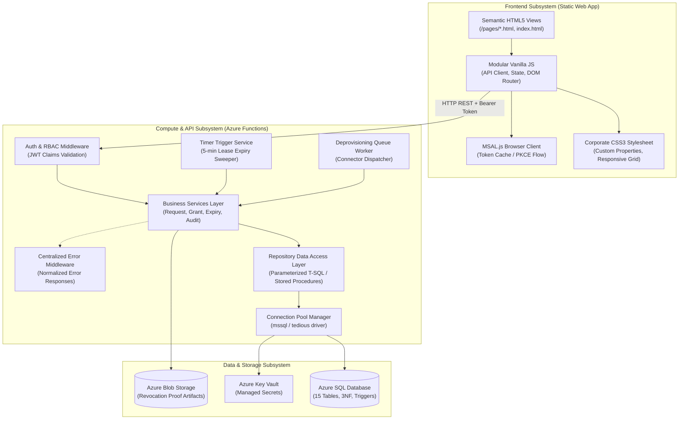
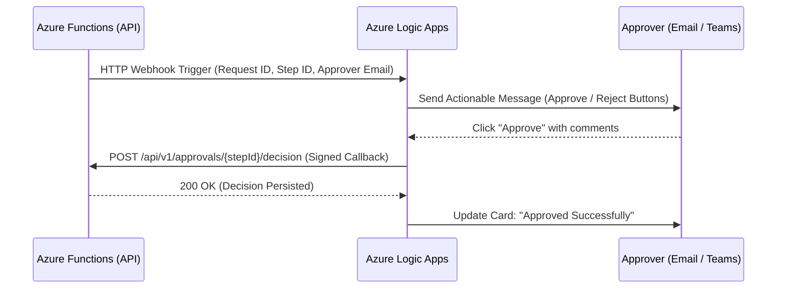

# AccessLease — Component Architecture & Subsystem Design

**Document Version:** 1.0.0  
**Phase:** STEP 02 — System Architecture & Technical Design  
**Author:** Senior Solution Architect & Cloud Architect  
**Classification:** Enterprise Engineering Specification  

---

## 1. Architectural Decomposition

AccessLease is architected around discrete, loosely coupled subsystems adhering to the Single Responsibility Principle. This document details the internal design, boundaries, interfaces, and error handling strategies for every system component.



---

## 2. Frontend Subsystem (Azure Static Web Apps)

### 2.1 Responsibilities & Technology Stack
* **Technologies:** HTML5, CSS3 (Modern Custom Properties, CSS Grid, Flexbox), Vanilla JavaScript (ES6+ Modules).
* **Hosting:** Azure Static Web Apps (SWA).
* **Core Responsibilities:**
  * Render accessible, responsive UI views for contractors, sponsors, resource owners, and compliance auditors.
  * Coordinate Single Sign-On (SSO) login flow with Microsoft Entra ID via `msal-browser.js` (standard unbundled ES module).
  * Maintain client-side session state without frontend frameworks.
  * Dispatch authenticated REST API requests containing Bearer tokens in the `Authorization` header.
  * Display real-time lease status, approval queues, exposure alerts, and audit logs.

### 2.2 Directory Organization
```text
frontend/
├── index.html                  # Landing page & authenticated dashboard shell
├── assets/
│   ├── css/
│   │   ├── main.css            # Global CSS variables, layout, typography, components
│   │   └── dashboard.css       # Data tables, exposure badges, modal dialogs
│   ├── js/
│   │   ├── main.js             # Application bootstrap & route coordinator
│   │   ├── auth.js             # MSAL.js initialization & token acquisition
│   │   ├── api-client.js       # Fetch wrapper with auto-bearer injection & error handling
│   │   ├── state.js            # Reactive vanilla pub/sub state manager
│   │   └── components/         # Modular vanilla DOM renderers (tables, alerts, modals)
│   └── images/                 # Logos, enterprise badges, icons
└── pages/
    ├── requests.html           # Request submission wizard
    ├── approvals.html          # Multi-stage approval inbox
    ├── grants.html             # Active contractor access lease table
    ├── exposure.html           # Real-time exposure queue & risk view
    ├── reviews.html            # Periodic recertification console
    └── audit.html              # Forensic audit trail explorer
```

### 2.3 Strict Engineering Governance
1. **No Frontend Frameworks:** No React, Angular, Vue, Svelte, Next.js, or similar frameworks are permitted.
2. **Vanilla JavaScript Only:** Pure browser-native DOM APIs (`document.querySelector`, `fetch`, `customElements`).
3. **No TypeScript on Frontend:** Native ES6+ JavaScript files to ensure zero frontend build compilation requirements.
4. **Separation of Concerns:** Zero inline styles or JavaScript handlers in HTML templates.

---

## 3. Compute & API Subsystem (Azure Functions Node.js v4)

### 3.1 Architecture & Programming Model
The backend compute tier utilizes the modern **Azure Functions Node.js v4 programming model** (`@azure/functions`). It separates serverless triggers from business domain logic and database persistence.

### 3.2 Subsystem Layering
```text
backend/
├── host.json                   # Functions host runtime configuration
├── local.settings.json         # Local environment settings (git-ignored)
├── package.json                # Dependencies (@azure/functions, mssql, dotenv)
└── src/
    ├── functions/              # Trigger Definitions (HTTP, Timer, Queue)
    │   ├── authMe.js           # GET /api/v1/auth/me
    │   ├── requests.js         # POST/GET /api/v1/requests
    │   ├── approvals.js        # GET/POST /api/v1/approvals
    │   ├── grants.js           # GET /api/v1/grants, POST activate
    │   ├── exposureQueue.js    # GET /api/v1/exposure-queue
    │   ├── reviews.js          # POST/GET /api/v1/reviews
    │   ├── audit.js            # GET /api/v1/audit-events
    │   ├── timerExpiry.js      # Timer Trigger (run every 5 min)
    │   └── queueRevoke.js      # Queue Trigger (connector deprovisioning)
    │
    ├── config/                 # Configuration & Constants
    │   ├── environment.js      # Environment variable validation & fallback
    │   ├── database.js         # Connection pool configuration for Azure SQL
    │   └── constants.js        # Status enums, error codes, risk tiers
    │
    ├── middleware/             # Request Pre/Post Processing
    │   ├── authMiddleware.js   # Entra ID JWT validation & claims extraction
    │   ├── rbacMiddleware.js   # Application role authorization check
    │   ├── correlation.js      # X-Correlation-ID injection & context binding
    │   └── errorHandler.js     # Global HTTP exception transformer
    │
    ├── services/               # Core Business Domain Logic
    │   ├── requestService.js   # Request validation, policy cap calculation
    │   ├── approvalService.js  # Multi-stage approval evaluation & escalation
    │   ├── grantService.js     # Grant activation coordination via sp_ActivateApprovedGrant
    │   ├── revocationService.js# Deprovisioning orchestration & proof verification
    │   ├── exposureService.js  # Exposure queue querying and metric calculation
    │   └── auditService.js     # Immutable audit event persistence
    │
    ├── repositories/           # Data Access Layer (T-SQL Queries)
    │   ├── userRepository.js
    │   ├── engagementRepository.js
    │   ├── resourceRepository.js
    │   ├── requestRepository.js
    │   ├── approvalRepository.js
    │   ├── grantRepository.js
    │   ├── revocationRepository.js
    │   └── auditRepository.js
    │
    └── utils/                  # Cross-Cutting Utilities
        ├── dbPool.js           # Singleton connection pool manager (mssql)
        ├── logger.js           # Structured JSON logger (Application Insights friendly)
        ├── cryptoUtils.js      # SHA-256 hash generation for revocation receipts
        └── blobStorage.js      # Azure Blob Storage SDK client wrapper
```

### 3.3 Connection Pooling & Resilience
* Uses the official `mssql` (`tedious`) driver configured with a shared singleton connection pool:
  * `pool.max = 20` connections per serverless instance.
  * `pool.min = 2` keep-alive connections.
  * `connectionTimeout = 30000 ms`.
  * Automatic retry with exponential backoff on transient connection drops (SQL Error 4060, 40197, 40501).
* All SQL queries are strictly parameterized to prevent SQL injection.

---

## 4. Relational Persistence Subsystem (Azure SQL Database)

### 4.1 Schema Integration
The persistence layer integrates the 15 core 3NF tables created in STEP 01:
* `users`, `contractor_engagements`, `roles`, `user_roles`
* `resources`, `entitlements`, `resource_owners`
* `access_requests`, `approval_steps`, `access_grants`
* `provisioning_events`, `revocation_jobs`
* `access_reviews`, `review_items`, `audit_events`

### 4.2 Database Engine Governance Objects
* **Stored Procedure [`sp_ActivateApprovedGrant`](file:///d:/access/database/procedures/005_create_activation_procedure.sql):** Executes within an ACID transaction; performs update locks on request records; validates all approval steps; enforces lease duration policy; prevents duplicate active grants; emits audit event.
* **Set-Based Trigger [`tr_ContractorGrantMustExpire`](file:///d:/access/database/triggers/006_create_contractor_expiry_trigger.sql):** Intercepts `INSERT` and `UPDATE` on `access_grants`; rejects missing or non-future expiry; rejects any expiry exceeding contractor engagement end date; rolls back multi-row batches atomically upon violation.
* **Reporting View [`v_AccessExposureQueue`](file:///d:/access/database/views/004_create_access_exposure_view.sql):** Exposes calculated metrics (`minutes_until_grant_expiry`, `days_until_engagement_expiry`), exposure categories (`EXPIRED_STILL_ACTIVE`, `ENGAGEMENT_TERMINATED_ACCESS_ACTIVE`, etc.), and risk severity tiers.

---

## 5. Storage Subsystem (Azure Blob Storage)

### 5.1 Responsibilities
* Stores cryptographic revocation proof bundles containing target connector raw responses, exit codes, execution timestamps, and operator IDs.
* Stores contractor Master Services Agreements (MSAs), Statements of Work (SOWs), and legal compliance waivers.
* Exports scheduled compliance audit packages.

### 5.2 Container Layout
```text
accesslease-storage/
├── revocation-proofs/          # Immutable WORM container for deprovisioning receipts
│   └── YYYY/
│       └── MM/
│           └── {grant_id}_{proof_hash}.json
├── contractor-documents/       # SOW and contract PDFs (encrypted at rest)
│   └── {engagement_id}/
│       └── SOW_{contract_reference}.pdf
└── audit-exports/              # Compliance review archives
    └── YYYY-QQ/
        └── AccessReview_Campaign_{review_id}.json.gz
```

### 5.3 Proof Receipt Artifact Structure
Each revocation receipt bundle persisted in `revocation-proofs/` adheres to a standardized JSON schema:
```json
{
  "proof_id": "9b1deb4d-3b7d-4bad-9bdd-2b0d7b3dcb6d",
  "grant_id": "c3b5d1a2-8f4e-4b6c-9a1d-7e8f9a0b1c2d",
  "grant_number": "AG-20261109-213000-A1B2",
  "contractor_user_id": "e4f5a6b7-c8d9-4e0f-1a2b-3c4d5e6f7a8b",
  "resource_code": "RES-SQL-PROD",
  "entitlement_code": "DB_READER",
  "trigger_source": "SCHEDULED_EXPIRATION",
  "connector_name": "AZURE_SQL_CONNECTOR",
  "connector_status_code": "200_OK",
  "connector_response_payload": {
    "action": "DROP_USER",
    "target_database": "accesslease-db",
    "executed_ts": "2026-11-09T21:30:00.123Z"
  },
  "execution_timestamp": "2026-11-09T21:30:00.150Z",
  "cryptographic_proof_hash_sha256": "e3b0c44298fc1c149afbf4c8996fb92427ae41e4649b934ca495991b7852b855",
  "verified_by_system": true
}
```

---

## 6. Secrets & Key Management Subsystem (Azure Key Vault)

### 6.1 Secret Architecture
All credentials and encryption keys are stored exclusively in Azure Key Vault:
* `SqlConnectionString`: Encrypted connection string to Azure SQL Database.
* `StorageAccountKey`: Key for Azure Blob Storage account.
* `EntraClientSecret`: Client secret for Microsoft Entra ID backend daemon credentials.
* `PowerBIClientSecret`: Service principal credential for Power BI Embedded.

### 6.2 Zero-Trust Access Strategy
* The Azure Functions compute instance uses a **System-Assigned Managed Identity**.
* Key Vault access policies grant the Functions identity `Get` and `List` permissions strictly on secrets.
* Local development relies on `Azure CLI` developer credentials via `@azure/identity` (`DefaultAzureCredential`), completely eliminating hardcoded passwords in local files.

---

## 7. Workflow & Notification Subsystem (Azure Logic Apps)

### 7.1 Architecture
Multi-stage approvals and escalation notifications require external communication (email, Microsoft Teams). Rather than burdening the synchronous API, Azure Functions dispatches asynchronous events to Azure Logic Apps:



### 7.2 Escalation Timer Workflows
* **48-Hour SLA Warning:** If an approval step remains in `PENDING` status for 48 hours, Logic Apps sends an automated escalation notice to the approver's manager.
* **Emergency Offboarding Notice:** When an engagement is terminated early, Logic Apps dispatches immediate high-priority alerts to the Security Operations Center (SOC).

---

## 8. Governance Analytics Subsystem (Microsoft Power BI)

### 8.1 Reporting Topology
* Power BI connects directly to Azure SQL Database using **DirectQuery** over Private Endpoints.
* Connects to reporting views (`v_AccessExposureQueue`) and aggregation tables.
* Embedded into the AccessLease web portal via Power BI Embedded JavaScript SDK with Row-Level Security (RLS) filtering based on the caller's Entra ID tenant and department.

### 8.2 Standard Analytics Views
1. **Executive Compliance Dashboard:** Active vs. expired grants, percent of grants with on-time revocation, recertification completion rate.
2. **Exposure Radar:** Real-time visualization of grants expiring in $< 48$ hours, overdue revocations, and orphan accounts.
3. **Vendor Risk Matrix:** Breakdown of active contractor counts, high-risk entitlements, and expiration timelines per contracting vendor.
