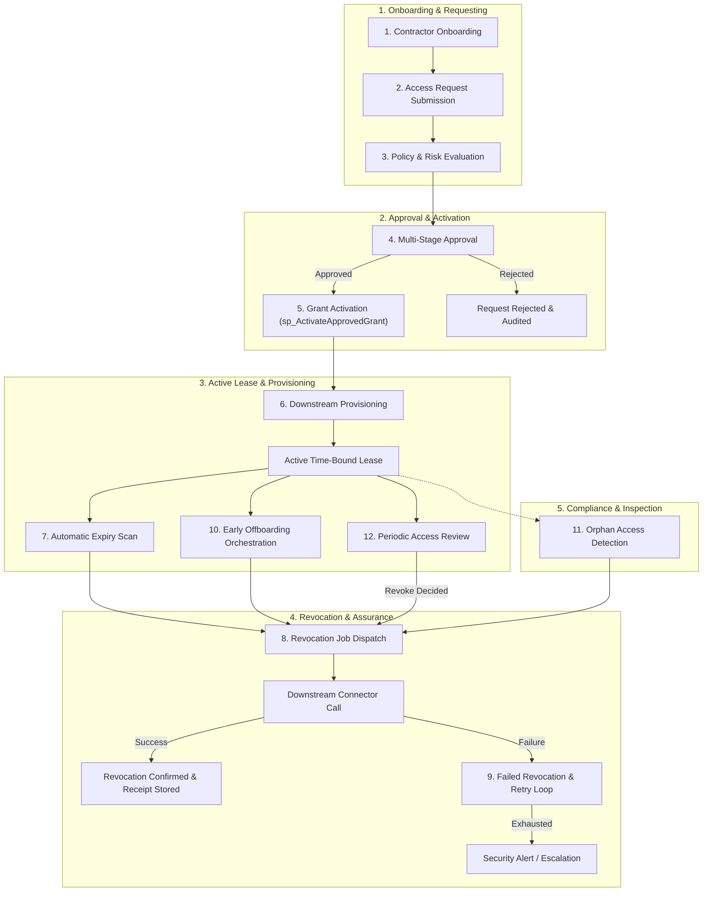

# AccessLease — Data Flow & Governance Workflow Design

**Document Version:** 1.0.0  
**Phase:** STEP 02 — System Architecture & Technical Design  
**Author:** Senior Solution Architect & Cloud Architect  
**Classification:** Enterprise Engineering Specification  

---

## 1. System-Wide Data Flow Overview

This document specifies the data movement, state transitions, validation boundaries, and audit logging for all 12 core lifecycle governance workflows in AccessLease.

---

## 2. End-to-End Governance Workflows

### 2.1 Workflow 1: Contractor Onboarding
* **Starting Event:** An external staffing firm or internal manager registers a new vendor engagement.
* **Responsible Component:** `engagementService.js` via `POST /api/v1/engagements`.
* **Processing Sequence:**
  1. Internal Sponsor submits contractor details (First Name, Last Name, Email, Vendor Name, SOW Contract Reference, Start Date, End Date).
  2. Service checks if contractor identity exists in Entra ID or creates guest invitation.
  3. Validates that `end_date >= start_date`.
* **Database Interaction:**
  * Inserts or matches user in `users` (`user_type = 'CONTRACTOR'`).
  * Inserts into `contractor_engagements` with `status = 'ACTIVE'` (or `'PENDING'` if contract start date is future).
* **Success Outcome:** Contractor engagement created with unique `engagement_id`.
* **Failure Outcome:** Returns `400 Bad Request` if dates are invalid or `409 Conflict` if contract reference already exists for user.
* **Audit Events:** Emits `event_category = 'CONTRACTOR'`, `event_action = 'ENGAGEMENT_ONBOARDED'`.

---

### 2.2 Workflow 2: Access Request Submission
* **Starting Event:** Business Sponsor submits an access request on behalf of a contractor.
* **Responsible Component:** `requestService.js` via `POST /api/v1/requests`.
* **Processing Sequence:**
  1. Validates that contractor engagement is currently `ACTIVE`.
  2. Validates that `requested_end_date > requested_start_date`.
  3. **Critical Rule B Check:** Ensures `requested_end_date` $\le$ contractor engagement `end_date`.
  4. Checks for existing active grants or pending requests for the same `(contractor_engagement_id, entitlement_id)`.
  5. Generates unique human-readable `request_number` (`AR-YYYYMMDD-XXXX`).
* **Database Interaction:**
  * Inserts record into `access_requests` with `status = 'SUBMITTED'`.
* **Success Outcome:** Returns `201 Created` with request summary and assigned ID.
* **Failure Outcome:** Rejects with `422 Unprocessable Entity` if dates exceed engagement end date or `409 Conflict` if duplicate request exists.
* **Audit Events:** Emits `event_category = 'ACCESS_REQUEST'`, `event_action = 'REQUEST_SUBMITTED'`.

---

### 2.3 Workflow 3: Policy & Risk Evaluation
* **Starting Event:** Request enters the system (triggered immediately post-submission).
* **Responsible Component:** `requestService.js` policy evaluation engine.
* **Processing Sequence:**
  1. Queries target `resources` and `entitlements` records.
  2. Inspects `risk_level` (`LOW`, `MEDIUM`, `HIGH`, `CRITICAL`) and `requires_security_approval`.
  3. Inspects resource `max_lease_duration_days`. If `DATEDIFF(day, start, end) > max_lease_duration_days`, truncates requested end date to policy limit or flags for exception.
  4. Determines required approval step pipeline:
     * Step 1: `SPONSOR_APPROVAL` (assigned to contractor's `sponsor_user_id`).
     * Step 2: `RESOURCE_OWNER_APPROVAL` (assigned to resource's `PRIMARY` owner).
     * Step 3: `SECURITY_APPROVAL` (injected if `requires_security_approval = 1` or risk level is `HIGH`/`CRITICAL`).
* **Database Interaction:**
  * Updates `access_requests.status = 'PENDING_APPROVAL'` and sets `requires_security_approval` flag.
  * Inserts generated steps into `approval_steps` with `status = 'PENDING'`.
* **Success Outcome:** Approval pipeline initialized and notifications dispatched.
* **Failure Outcome:** Request marked `REJECTED` if target resource is inactive.
* **Audit Events:** Emits `event_category = 'ACCESS_REQUEST'`, `event_action = 'POLICY_EVALUATED'`.

---

### 2.4 Workflow 4: Multi-Stage Approval
* **Starting Event:** Designated approver inspects approval inbox and submits decision.
* **Responsible Component:** `approvalService.js` via `POST /api/v1/approvals/{stepId}/decision`.
* **Processing Sequence:**
  1. Verifies caller identity matches `assigned_approver_user_id` or is authorized delegate/admin.
  2. Validates step status is `PENDING`.
  3. If decision is `REJECTED`:
     * Updates current step to `REJECTED`.
     * Immediately transitions parent `access_requests.status = 'REJECTED'`.
     * Skips remaining downstream steps.
  4. If decision is `APPROVED`:
     * Updates current step to `APPROVED` with `decided_at = SYSDATETIMEOFFSET()`.
     * Checks if subsequent steps exist. If yes, activates next step notification.
     * If all steps are now `APPROVED`, marks parent `access_requests.status = 'APPROVED'` and triggers Grant Activation.
* **Database Interaction:**
  * Updates `approval_steps` table.
  * Updates `access_requests` table.
* **Success Outcome:** Step completed; downstream workflow triggered.
* **Failure Outcome:** Returns `403 Forbidden` if caller is not assigned approver; `400 Bad Request` if step already finalized.
* **Audit Events:** Emits `event_category = 'APPROVAL'`, `event_action = 'STEP_APPROVED'` or `'STEP_REJECTED'`.

---

### 2.5 Workflow 5: Grant Activation
* **Starting Event:** Access request achieves `APPROVED` status with all approval steps complete.
* **Responsible Component:** `grantService.js` invoking stored procedure [`sp_ActivateApprovedGrant`](file:///d:/access/database/procedures/005_create_activation_procedure.sql).
* **Processing Sequence:**
  1. Executes within an ACID transaction.
  2. Re-verifies approval steps, engagement status, and active dates under exclusive update lock.
  3. Deterministically computes `expires_at` as:
     $$\text{expires\_at} = \min(\text{RequestedEndDate}, \text{CurrentTime} + \text{MaxDurationDays}, \text{EngagementEndDate})$$
  4. Generates unique `grant_number` (`AG-YYYYMMDD-XXXX`).
  5. Inserts active grant into `access_grants`.
  6. Dispatches provisioning event.
* **Database Interaction:**
  * Procedure inserts into `access_grants` (`status = 'ACTIVE'`).
  * Inserts initial record into `provisioning_events`.
  * Emits entry in `audit_events`.
* **Success Outcome:** Grant activated with hard expiration timestamp returned to caller.
* **Failure Outcome:** Procedure throws custom error (e.g., `50003: Approval Workflow Incomplete`, `50008: Duplicate Grant Conflict`), triggering rollback.
* **Audit Events:** Emits `event_category = 'GRANT'`, `event_action = 'GRANT_ACTIVATED'`.

---

### 2.6 Workflow 6: Downstream Provisioning
* **Starting Event:** Grant enters `ACTIVE` status (or `PROVISIONING_PENDING`).
* **Responsible Component:** `provisioningWorker.js` (Queue Trigger).
* **Processing Sequence:**
  1. Retrieves target connector name and resource configuration (e.g. Azure Entra ID Graph API, Azure SQL user provisioning, AWS IAM).
  2. Executes target system API call (e.g., adding user to target Entra Security Group).
  3. Captures raw JSON response and HTTP status code.
* **Database Interaction:**
  * Inserts execution results into `provisioning_events` with `event_type = 'PROVISION_SUCCEEDED'` or `'PROVISION_FAILED'`.
* **Success Outcome:** Provisioning confirmed; contractor possesses access.
* **Failure Outcome:** If connector call fails, records error in `provisioning_events` and enqueues retry.
* **Audit Events:** Emits `event_category = 'PROVISIONING'`, `event_action = 'PROVISIONING_SUCCEEDED'`.

---

### 2.7 Workflow 7: Automatic Expiry
* **Starting Event:** Azure Functions Timer Trigger executes every 5 minutes (`timerExpiry.js`).
* **Responsible Component:** `lifecycleScheduler.js`.
* **Processing Sequence:**
  1. Queries `access_grants` for grants where `status = 'ACTIVE'` AND `expires_at <= SYSDATETIMEOFFSET()`.
  2. For each identified grant, initiates immediate deprovisioning by creating a revocation job.
* **Database Interaction:**
  * Transitions `access_grants.status` from `'ACTIVE'` to `'REVOKE_PENDING'`.
  * Inserts record into `revocation_jobs` with `trigger_source = 'SCHEDULED_EXPIRATION'` and `status = 'QUEUED'`.
* **Success Outcome:** All expired leases identified, marked `REVOKE_PENDING`, and queued for worker execution.
* **Failure Outcome:** Transient database errors trigger alert in Application Insights; re-evaluated on next 5-minute cycle.
* **Audit Events:** Emits `event_category = 'REVOCATION'`, `event_action = 'LEASE_EXPIRED_REVOCATION_QUEUED'`.

---

### 2.8 Workflow 8: Revocation Execution & Cryptographic Assurance
* **Starting Event:** Deprovisioning job appears in queue (`revocation_jobs` with `status = 'QUEUED'`).
* **Responsible Component:** `revocationWorker.js`.
* **Processing Sequence:**
  1. Acquires job and marks `status = 'IN_PROGRESS'`.
  2. Calls target connector (e.g., Microsoft Graph API to remove user from security group, SQL script to drop user, VPN revoke).
  3. **Strict Downstream Confirmation Rule:** Access is **NOT** marked revoked until target system confirms removal.
  4. Upon confirmation:
     * Generates SHA-256 cryptographic receipt hash from `{grant_id, timestamp, connector_response}`.
     * Uploads proof receipt bundle to Azure Blob Storage container `revocation-proofs/`.
     * Updates job record with blob URL and confirmation timestamp.
     * Transitions `access_grants.status = 'REVOKED'` and sets `revoked_at = SYSDATETIMEOFFSET()`.
* **Database Interaction:**
  * Updates `revocation_jobs` (`status = 'CONFIRMED'`).
  * Updates `access_grants` (`status = 'REVOKED'`).
  * Inserts proof verification log into `audit_events`.
* **Success Outcome:** Contractor access is verifiably revoked with tamper-resistant audit proof.
* **Failure Outcome:** Transitions to Workflow 9 (Failed Revocation & Retry).
* **Audit Events:** Emits `event_category = 'REVOCATION'`, `event_action = 'REVOCATION_CONFIRMED'`.

---

### 2.9 Workflow 9: Failed Revocation and Retry
* **Starting Event:** Downstream connector call encounters a network failure, rate limit (HTTP 429), or target system error (HTTP 500+).
* **Responsible Component:** `revocationWorker.js` error handler.
* **Processing Sequence:**
  1. Captures connector error details and stack trace.
  2. **Grant Status Governance:** The grant remains strictly in `'REVOKE_PENDING'`. It is **NEVER** marked `'REVOKED'`.
  3. Increments `retry_count` on `revocation_jobs`.
  4. If `retry_count < max_retries` (default 5):
     * Computes exponential backoff delay: $\text{Delay} = 2^{\text{retry\_count}} \times 30\text{ seconds}$.
     * Sets job `status = 'FAILED_RETRY'` and schedules next execution.
  5. If `retry_count >= max_retries`:
     * Marks job `status = 'FAILED_RETRY'` (terminal retry state).
     * Raises high-priority security alert in Azure Monitor / SOC.
     * Appears in `v_AccessExposureQueue` as `REVOCATION_PENDING_CONFIRMATION` with `CRITICAL` severity.
* **Database Interaction:**
  * Updates `revocation_jobs` with retry metrics and error logs.
* **Success Outcome:** Subsequent retry succeeds and triggers Workflow 8 completion.
* **Failure Outcome:** Escalated to on-call security engineer for manual intervention.
* **Audit Events:** Emits `event_category = 'REVOCATION'`, `event_action = 'REVOCATION_RETRY_FAILED'`.

---

### 2.10 Workflow 10: Early Offboarding Orchestration
* **Starting Event:** Internal Sponsor or HR terminates contractor engagement prior to scheduled end date.
* **Responsible Component:** `offboardingService.js` via `POST /api/v1/engagements/{id}/offboard`.
* **Processing Sequence:**
  1. Validates caller is authorized sponsor or administrator.
  2. Queries all active grants (`status IN ('ACTIVE', 'PROVISIONING_PENDING')`) tied to the `engagement_id`.
  3. In a single transaction:
     * Updates `contractor_engagements.status = 'TERMINATED'`.
     * Transitions all associated active grants to `REVOKE_PENDING`.
     * Enqueues high-priority revocation jobs for each grant with `trigger_source = 'ENGAGEMENT_TERMINATION'`.
* **Database Interaction:**
  * Updates `contractor_engagements`.
  * Updates `access_grants`.
  * Inserts multiple records into `revocation_jobs`.
* **Success Outcome:** All entitlements for contractor scheduled for immediate deprovisioning.
* **Failure Outcome:** Rejects if engagement already terminated.
* **Audit Events:** Emits `event_category = 'CONTRACTOR'`, `event_action = 'ENGAGEMENT_EARLY_TERMINATION'`.

---

### 2.11 Workflow 11: Orphan Access Detection
* **Starting Event:** Daily scheduled timer scan or on-demand exposure audit.
* **Responsible Component:** `exposureService.js` querying [`v_AccessExposureQueue`](file:///d:/access/database/views/004_create_access_exposure_view.sql).
* **Processing Sequence:**
  1. Executes query against `v_AccessExposureQueue` filtering for:
     * `exposure_category = 'ENGAGEMENT_TERMINATED_ACCESS_ACTIVE'`
     * `exposure_category = 'EXPIRED_STILL_ACTIVE'`
  2. For every exposed grant detected without an active in-flight revocation job, auto-remediates by generating a revocation job.
* **Database Interaction:**
  * Inserts remediation jobs into `revocation_jobs` with `trigger_source = 'MANUAL_EMERGENCY'`.
* **Success Outcome:** Zero lingering orphan entitlements remain unrevoked.
* **Failure Outcome:** Alerts compliance officer if remediation job creation fails.
* **Audit Events:** Emits `event_category = 'SECURITY_POLICY'`, `event_action = 'ORPHAN_ACCESS_DETECTED_REMEDIATED'`.

---

### 2.12 Workflow 12: Periodic Access Review (Recertification)
* **Starting Event:** Compliance Officer launches quarterly contractor recertification campaign.
* **Responsible Component:** `reviewService.js` via `POST /api/v1/reviews`.
* **Processing Sequence:**
  1. Validates review parameters (Campaign Name, Scope, Due Date).
  2. Queries all currently active grants matching campaign scope.
  3. Inserts campaign header into `access_reviews`.
  4. Populates `review_items` for each grant, assigning reviewer (resource owner or sponsor).
  5. Dispatches notification to reviewers.
  6. Reviewer evaluates each grant and records attestation (`MAINTAIN` or `REVOKE`).
  7. If reviewer submits `REVOKE`:
     * System immediately enqueues a revocation job with `trigger_source = 'REVIEW_REJECTION'`.
     * Transitions grant to `REVOKE_PENDING`.
* **Database Interaction:**
  * Inserts into `access_reviews` and `review_items`.
  * Updates `review_items` with decision.
* **Success Outcome:** Campaign completed; uncertified access grants automatically revoked.
* **Failure Outcome:** Review campaign marked `EXPIRED` if past due date without full completion.
* **Audit Events:** Emits `event_category = 'RECERTIFICATION'`, `event_action = 'CAMPAIGN_LAUNCHED'` and `'ITEM_ATTESTED'`.
