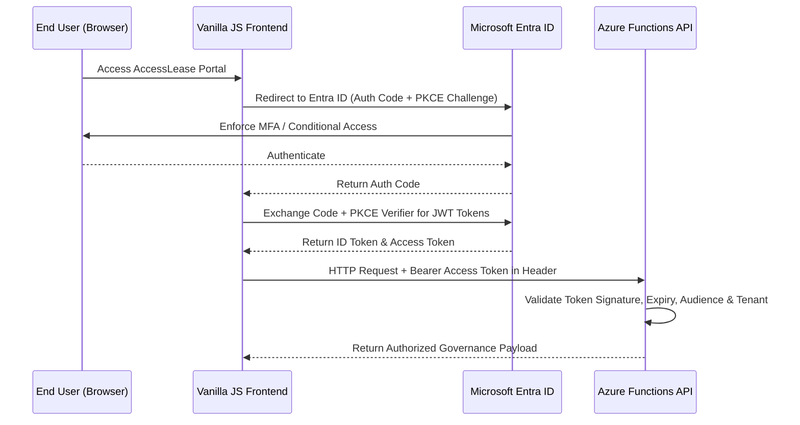
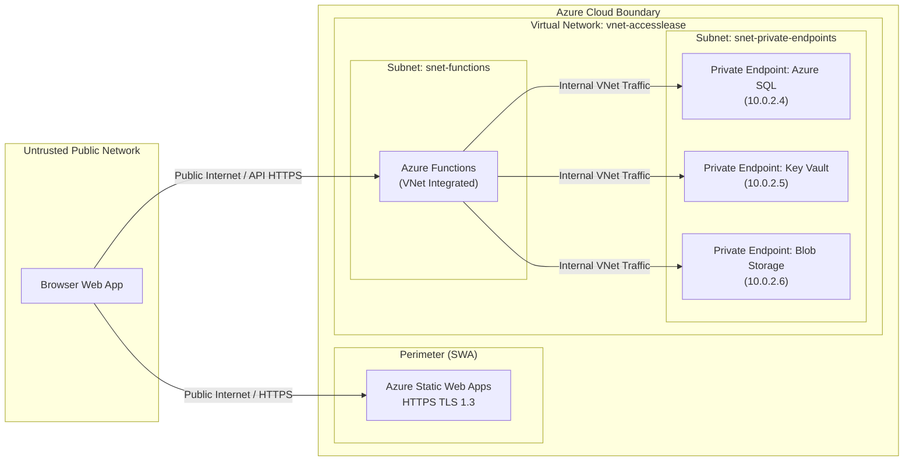

# AccessLease — Security Architecture & Threat Defense Design

**Document Version:** 1.0.0  
**Phase:** STEP 02 — System Architecture & Technical Design  
**Author:** Senior Solution Architect & Cloud Security Engineer  
**Classification:** Enterprise Engineering Specification  

---

## 1. Security Philosophy & Zero-Trust Architecture

AccessLease governs enterprise access for untrusted and temporary contractor identities. Consequently, the application operates under a strict **Zero-Trust Security Model**:
1. **Verify Explicitly:** Always authenticate and authorize based on all available data points (identity, claims, resource risk, role).
2. **Use Least-Privileged Access:** Limit user access with Just-In-Time (JIT) and Just-Enough-Access (JEA) time-bound leases.
3. **Assume Breach:** Minimize blast radius by segmenting network access, encrypting all data in transit and at rest, and recording tamper-resistant audit logs.

> [!NOTE]
> **Status Disclosure:** This document outlines the architectural specifications and controls designed for the AccessLease platform. In accordance with project standards, controls are labeled as **[Architectural Design Specification]** until fully coded, deployed, and verified in subsequent implementation steps.

---

## 2. Authentication Architecture (Microsoft Entra ID)

### 2.1 Identity Protocol: OAuth 2.0 & OpenID Connect
* **Identity Provider:** Microsoft Entra ID (formerly Azure Active Directory).
* **Protocol Flow:** Authorization Code Flow with Proof Key for Code Exchange (PKCE) for browser single-page vanilla applications (via MSAL.js).
* **Password Policy:** AccessLease **NEVER** collects, handles, or stores user passwords. Authentication is offloaded entirely to Microsoft Entra ID, inheriting enterprise Multi-Factor Authentication (MFA), Conditional Access policies, and passwordless authentication (FIDO2 / Windows Hello).



### 2.2 JWT Token Validation Rules
Every inbound request to the Azure Functions API layer is intercepted by `authMiddleware.js`, which strictly validates:
1. **Signature Integrity:** Cryptographically verified against Microsoft's public OpenID Connect keys retrieved from `https://login.microsoftonline.com/{tenant_id}/discovery/v2.0/keys`.
2. **Issuer (`iss`):** Must strictly match `https://login.microsoftonline.com/{tenant_id}/v2.0`.
3. **Audience (`aud`):** Must strictly match the backend Application ID URI `api://{entra_client_id}`.
4. **Token Expiration (`exp`):** Reject expired tokens with clock-skew tolerance $\le 60\text{ seconds}$.
5. **Subject Correlation:** Correlates the `oid` (Object ID) claim to the internal `users.entra_object_id` table.

---

## 3. Authorization Architecture (Application RBAC)

### 3.1 Role Hierarchy & Mapping
While Entra ID authenticates *who* a user is, AccessLease governs *what* a user can perform within the access governance system via the database tables `roles` and `user_roles`.

```text
┌──────────────────────┬───────────────────────────────────────────────────────────────┐
│ Role Code            │ Core System Permissions & Authorities                         │
├──────────────────────┼───────────────────────────────────────────────────────────────┤
│ SYSTEM_ADMIN         │ Configure resources, manage system roles, override policies.  │
│ SECURITY_OFFICER     │ Approve high-risk access requests, trigger emergency revokes. │
│ COMPLIANCE_AUDITOR   │ Read-only inspection of audit events, reports, and reviews.   │
│ RESOURCE_OWNER       │ Approve/reject access requests for assigned resources.        │
│ INTERNAL_SPONSOR     │ Onboard contractors, submit access requests, sponsor leases.  │
│ CONTRACTOR           │ Self-service view of currently assigned access grants.        │
└──────────────────────┴───────────────────────────────────────────────────────────────┘
```

### 3.2 Least Privilege & Separation of Duties (SoD)
The system enforces hard separation of duties to prevent privilege escalation:
* **Anti-Self-Approval Rule:** An internal sponsor cannot approve an access request they authored if they also happen to be a resource owner.
* **Contractor Authorization Block:** Contractors are strictly prevented from submitting access requests or participating in approval workflows.
* **Dual-Custodian High-Risk Policy:** Any entitlement classified as `CRITICAL` or on a resource where `requires_security_approval = 1` requires both Resource Owner signoff AND an independent Security Officer signoff.

---

## 4. Cryptographic Security & Secrets Management

### 4.1 Encryption in Transit
* All network communication strictly enforces **TLS 1.3** (with TLS 1.2 as minimum allowable fallback).
* Plain HTTP traffic is automatically upgraded to HTTPS via Azure Static Web Apps and Azure Front Door rewrite rules.
* Strict-Transport-Security (HSTS) headers enforced: `max-age=31536000; includeSubDomains; preload`.

### 4.2 Encryption at Rest
* **Azure SQL Database:** Protected by **Transparent Data Encryption (TDE)** with service-managed or customer-managed keys (CMK) in Azure Key Vault.
* **Azure Blob Storage:** Enforces 256-bit AES Server-Side Encryption (SSE) across all containers.

### 4.3 Zero-Trust Secret Management via Azure Key Vault
* Zero application secrets, connection strings, or API tokens are checked into version control or written in application code.
* The Azure Functions compute runtime connects to Azure Key Vault via **System-Assigned Azure Managed Identity (MSI)**.
* Key Vault references are injected into serverless application settings at runtime:
  `@Microsoft.KeyVault(SecretUri=https://kv-accesslease.vault.azure.net/secrets/SqlConnectionString/)`

---

## 5. Defense Against Common Web Vulnerabilities

| Threat / Vulnerability | OWASP Category | AccessLease Defensive Mitigation |
| :--- | :--- | :--- |
| **SQL Injection (SQLi)** | A03:2021-Injection | 100% of database interactions execute via parameterized queries (`mssql.Request.input()`) or pre-compiled stored procedures. Dynamic string concatenation in SQL is prohibited. |
| **Cross-Site Scripting (XSS)** | A03:2021-Injection | Vanilla JS frontend utilizes `textContent` and `createElement()` exclusively; avoids `innerHTML` with unsanitized data. Enforces strict Content Security Policy (CSP). |
| **Cross-Site Request Forgery (CSRF)** | A01:2021-Broken Access Control | Stateless REST API relies on bearer tokens in the `Authorization: Bearer <token>` header rather than ambient browser cookies. |
| **Broken Object Level Auth (BOLA)** | A01:2021-Broken Access Control | Every API endpoint queries database records with tenancy and ownership filters (e.g. verifying request belongs to caller's contractor). |
| **Security Misconfiguration** | A05:2021-Security Misconfiguration | Security response headers applied to all responses: `X-Content-Type-Options: nosniff`, `X-Frame-Options: DENY`, `Referrer-Policy: strict-origin-when-cross-origin`. |
| **Broken Access Control** | A01:2021-Broken Access Control | Database check constraints (`CK_access_grants_dates`), set-based trigger `tr_ContractorGrantMustExpire`, and procedure `sp_ActivateApprovedGrant`. |

---

## 6. Network Segmentation & Infrastructure Hardening



* **Private Endpoints (Private Link):** Azure SQL Database, Azure Key Vault, and Azure Blob Storage have their public IP firewalls completely disabled. They accept traffic exclusively over dedicated private IP addresses within `snet-private-endpoints`.
* **VNet Compute Integration:** Azure Functions utilizes Regional VNet Integration to route all outbound traffic through the corporate virtual network.

---

## 7. Secure Document Access (Shared Access Signatures)

* Contractor contracts (SOWs) and cryptographic revocation proof receipts stored in Azure Blob Storage are **never** made publicly accessible.
* Access is granted exclusively via **Shared Access Signatures (SAS)** generated on-demand by the API layer for authenticated authorized users:
  * Signed with User Delegation Keys tied to Entra ID credentials.
  * Maximum validity lifetime (TTL) strictly capped at **15 minutes**.
  * Permissions restricted strictly to `Read` (`r`).

---

## 8. Forensic Auditability & Tamper Resistance

* Every state mutation across the application emits a permanent, structured entry into `audit_events`.
* The `audit_events` table is append-only (`INSERT` permitted; `UPDATE` and `DELETE` denied at the database user permission level).
* Revocation receipts include a SHA-256 hash computed over the connector payload, timestamp, and target resource ID to ensure non-repudiation during enterprise compliance examinations.
