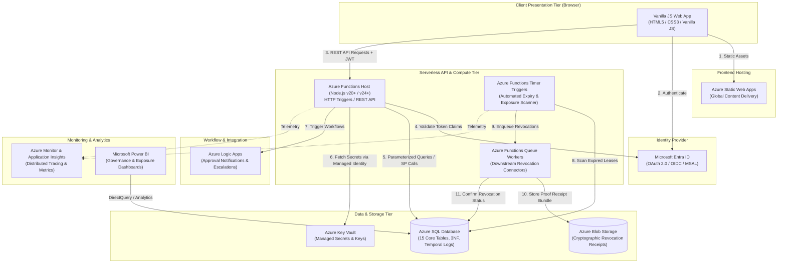
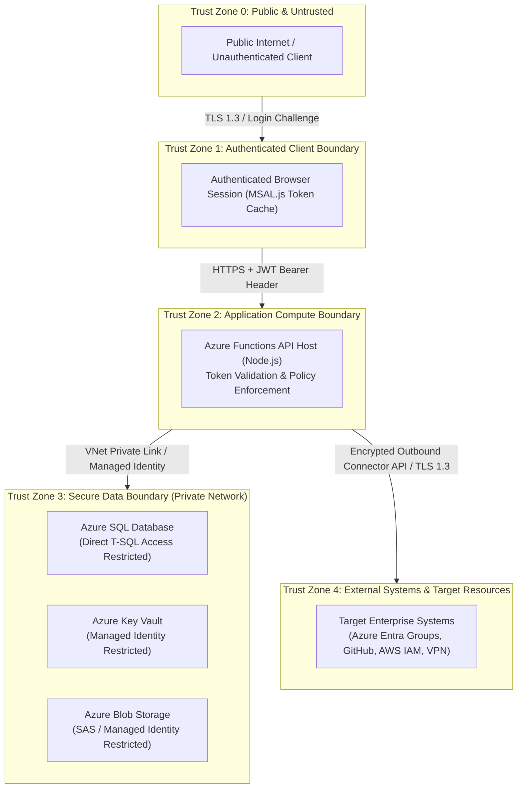

# AccessLease — System Architecture & Technical Design

**Document Version:** 1.0.0  
**Phase:** STEP 02 — System Architecture & Technical Design  
**Author:** Senior Solution Architect & Cloud Architect  
**Classification:** Enterprise Engineering Specification  

---

## 1. Executive Summary

**AccessLease** is an enterprise-grade contractor access governance and automated offboarding platform. It enforces a strict **Five-Pillar Governance Model**: every contractor access entitlement is **Owned**, **Approved**, **Time-Bound**, **Reviewable**, and **Verifiably Revoked**.

This document establishes the technical baseline, high-level architecture, deployment topology, trust boundaries, and functional/non-functional requirements for AccessLease across Microsoft Azure cloud services.

---

## 2. High-Level Architecture

The system operates across five core architectural tiers:
1. **Presentation Tier:** Pure HTML5, CSS3, and Vanilla JavaScript hosted globally via Azure Static Web Apps.
2. **Identity & Access Tier:** Microsoft Entra ID (OAuth 2.0 / OpenID Connect) handling Single Sign-On (SSO) and bearer token issuance.
3. **API & Serverless Compute Tier:** Modular Node.js Azure Functions (HTTP triggers, Timer triggers, and Queue triggers) with centralized middleware.
4. **Data & Storage Tier:** Azure SQL Database (3NF transactional authority), Azure Blob Storage (immutable cryptographic revocation proofs and SOW artifacts), and Azure Key Vault (zero-trust secret management).
5. **Workflow & Analytics Tier:** Azure Logic Apps (enterprise notifications and multi-stage approval escalations) and Microsoft Power BI (embedded compliance and exposure dashboards).



---

## 3. Component Architecture

| Component | Technology | Primary Responsibilities | Boundaries & Constraints |
| :--- | :--- | :--- | :--- |
| **Frontend Portal** | HTML5, CSS3, Vanilla JavaScript (ES6+) | User interaction, responsive dashboards, request submission wizard, approval inbox, access review attestations. | Pure client-side execution. Strictly zero business logic validation reliance; no npm frontend frameworks or TypeScript. |
| **Hosting Platform** | Azure Static Web Apps | Global static content delivery, custom domain binding, HTTPS enforcement, basic edge caching. | Serves pre-built static assets only; no server-side Node rendering. |
| **Identity Authority** | Microsoft Entra ID | Enterprise SSO, Multi-Factor Authentication (MFA), OAuth2 Authorization Code Flow with PKCE, JWT issuance. | External identity boundary. Does not store application-specific roles directly (mapped via `users` and `user_roles`). |
| **REST API Engine** | Node.js, Azure Functions (HTTP) | Authentication token validation, role authorization, request intake, policy validation, grant management, and CRUD operations. | Stateless compute. All state persisted in Azure SQL. Strictly parameterized queries. |
| **Lifecycle Scheduler** | Azure Functions (Timer) | Periodic automated sweeps (e.g. every 5 minutes) identifying expiring grants, expired engagements, and overdue recertifications. | Read-heavy scanner calling stored procedures and dispatching asynchronous revocation jobs. |
| **Deprovisioning Worker**| Azure Functions (Queue) | Executes connector actions (Entra ID group removal, SQL user drop, VPN revoke), generates SHA-256 proofs, persists receipts in Blob. | Asynchronous isolation. Revocation confirmed only upon downstream connector verification. |
| **Relational Authority** | Azure SQL Database | 15 core tables, relational integrity, foreign keys, set-based triggers (`tr_ContractorGrantMustExpire`), views, and procedures. | Single source of relational truth. No unparameterized dynamic SQL allowed. |
| **Proof Repository** | Azure Blob Storage | Stores immutable JSON proof bundles, connector responses, SHA-256 receipts, and contract documents. | Immutable WORM (Write Once, Read Many) policies with SAS-token controlled access. |
| **Secret Manager** | Azure Key Vault | Stores database connection strings, client secrets, storage account keys, and encryption keys. | Accessible exclusively via system-assigned Azure Managed Identities; zero hardcoded secrets. |
| **Workflow Engine** | Azure Logic Apps | Orchestrates multi-stage approval emails, Teams actionable messages, and SLA escalation alerts. | Triggered via HTTP webhooks or service bus from Azure Functions; does not perform direct database mutations. |
| **Governance BI** | Microsoft Power BI | Executive compliance reporting, lease aging metrics, exposure heatmaps, and audit trend analysis. | Read-only reporting accessing views (`v_AccessExposureQueue`) via Azure SQL DirectQuery. |
| **Telemetry System** | Azure Monitor & Application Insights | Centralized logging, distributed request tracing, dependency tracking, failure alerts, and audit streaming. | Receives structured JSON logs with correlation IDs from all serverless triggers. |

---

## 4. Deployment Architecture

AccessLease is deployed in Microsoft Azure within a secured cloud boundary:

```mermaid
flowchart LR
    subgraph Internet ["Public Internet"]
        Browser["End-User Browser"]
    end

    subgraph AzureCloud ["Microsoft Azure Cloud"]
        subgraph Perimeter ["Edge & Delivery"]
            SWA["Azure Static Web Apps<br/>(Custom Domain + TLS 1.3)"]
        end

        subgraph VNet ["Secure Azure Virtual Network (VNet)"]
            subgraph AppSubnet ["Serverless Compute Subnet"]
                FuncApp["Azure Functions App<br/>(Node.js Consumption/Flex Plan)<br/>Private VNet Integration"]
            end

            subgraph DataSubnet ["Data & Persistence Subnet (Private Endpoints)"]
                SQLPE["Azure SQL Private Endpoint<br/>(Port 1433)"]
                BlobPE["Azure Storage Private Endpoint<br/>(Port 443)"]
                KVPE["Azure Key Vault Private Endpoint<br/>(Port 443)"]
            end
        end

        subgraph CloudSaaS ["Managed Azure Services"]
            EntraID["Microsoft Entra ID Tenant"]
            AppInsights["Application Insights"]
            PowerBISvc["Power BI Embedded Service"]
            LogicAppsSvc["Azure Logic Apps (Consumption)"]
        end
    end

    Browser -->|HTTPS / Port 443| SWA
    Browser -->|OAuth 2.0 / OIDC| EntraID
    Browser -->|API Calls (HTTPS / Bearer Token)| FuncApp
    FuncApp -->|VNet Integration| SQLPE
    FuncApp -->|VNet Integration| BlobPE
    FuncApp -->|VNet Integration| KVPE
    FuncApp -->|Webhook Trigger| LogicAppsSvc
    FuncApp -.->|Telemetry| AppInsights
    PowerBISvc -->|Private Link / Gateway| SQLPE
```

### Infrastructure Components & SKU Recommendations:
* **Resource Group:** `rg-accesslease-prod` (e.g., East US / West Europe).
* **Azure Static Web Apps:** Standard tier (supports custom domain, custom authentication routing, and private endpoints).
* **Azure Functions:** Flex Consumption or Premium Plan (VNet integration, scale-to-zero capability with minimal cold start).
* **Azure SQL Database:** General Purpose (vCore-based) or Business Critical with Zone Redundancy and Automated Backups.
* **Azure Storage Account:** Standard General Purpose v2 (ZRS - Zone Redundant Storage, Hierarchical Namespace enabled for proof logs).
* **Azure Key Vault:** Standard tier with Soft-Delete, Purge Protection, and Role-Based Access Control (Azure RBAC).
* **Virtual Network:** `vnet-accesslease` with dedicated subnets for compute delegation (`snet-functions`) and private endpoints (`snet-data`).

---

## 5. Trust Boundaries & Security Zones

The architecture delineates five distinct trust zones:



* **Boundary A (Zone 0 $\rightarrow$ Zone 1):** Identity gate enforced by Microsoft Entra ID. No unauthenticated user can acquire a bearer token.
* **Boundary B (Zone 1 $\rightarrow$ Zone 2):** API authentication gate. Azure Functions middleware validates JWT cryptographic signature, tenant, audience, expiration, and user status.
* **Boundary C (Zone 2 $\rightarrow$ Zone 3):** Infrastructure private boundary. Azure SQL and Key Vault deny all public IP traffic; communication occurs strictly over private endpoints within the virtual network using Azure Managed Identity.
* **Boundary D (Zone 2 $\rightarrow$ Zone 4):** Downstream integration boundary. Outbound connector calls require mutual TLS or API keys fetched dynamically from Key Vault.

---

## 6. System Functional Requirements

### 6.1 User & Role Management
* **FR-USR-01:** System shall ingest user identity principals from Microsoft Entra ID (`entra_object_id`) and correlate them into the `users` table.
* **FR-USR-02:** System shall support user type classification: `INTERNAL_EMPLOYEE` and `CONTRACTOR`.
* **FR-USR-03:** System shall provide Role-Based Access Control (RBAC) via `roles` and `user_roles` with roles: `SYSTEM_ADMIN`, `SECURITY_OFFICER`, `COMPLIANCE_AUDITOR`, `RESOURCE_OWNER`, and `INTERNAL_SPONSOR`.
* **FR-USR-04:** Deactivation of a user in Entra ID shall immediately disable their active session upon next token expiry or revocation check.

### 6.2 Contractor Engagement Management
* **FR-ENG-01:** Every contractor must be linked to a valid `contractor_engagements` record defining vendor name, contract reference, start date, and hard end date.
* **FR-ENG-02:** Every contractor engagement must be assigned an internal, accountable business sponsor (`sponsor_user_id`).
* **FR-ENG-03:** The system shall prevent access request submissions for engagements in `PENDING`, `COMPLETED`, or `TERMINATED` status.

### 6.3 Resource & Entitlement Catalogues
* **FR-CAT-01:** The system shall maintain an authorized catalog of enterprise `resources` classified by type (`SAAS`, `CLOUD_SUBSCRIPTION`, `DATABASE`, `REPOSITORY`, `NETWORK_VPN`, `INTERNAL_APP`).
* **FR-CAT-02:** Each resource must have assigned `resource_owners` (classified as `PRIMARY`, `DELEGATE`, or `TECHNICAL_CONTACT`).
* **FR-CAT-03:** Resources must define a `risk_level` (`LOW`, `MEDIUM`, `HIGH`, `CRITICAL`) and a policy cap `max_lease_duration_days` (1 to 365 days).
* **FR-CAT-04:** Specific entitlements within a resource must define a `sensitivity_level` and permission code.

### 6.4 Access Requests & Policy Evaluation
* **FR-REQ-01:** Internal sponsors shall submit access requests detailing target entitlement, start/end dates, and business justification.
* **FR-REQ-02:** The system shall reject any request where `requested_end_date` exceeds the contractor engagement `end_date`.
* **FR-REQ-03:** The system shall reject duplicate active requests for the same contractor and entitlement.
* **FR-REQ-04:** The system shall automatically flag requests for resources marked `requires_security_approval = 1` or risk level `HIGH`/`CRITICAL` to require mandatory Security Officer approval.

### 6.5 Multi-Stage Approvals
* **FR-APP-01:** System shall generate sequential approval steps in `approval_steps` upon request submission:
  * Stage 1: `SPONSOR_APPROVAL` (Internal business sponsor attestation).
  * Stage 2: `RESOURCE_OWNER_APPROVAL` (Target system owner attestation).
  * Stage 3: `SECURITY_APPROVAL` (Mandatory if resource or entitlement is high-risk).
* **FR-APP-02:** An approver may approve, reject, or return comments. Rejection at any stage immediately transitions the request to `REJECTED`.
* **FR-APP-03:** Sponsors cannot approve requests where they are also the beneficiary.

### 6.6 Grant Activation & Deterministic Expiry
* **FR-GRT-01:** Access grants shall be activated exclusively via `sp_ActivateApprovedGrant` within an ACID transaction.
* **FR-GRT-02:** Grant expiry timestamp `expires_at` is deterministically calculated as $\min(\text{RequestedEndDate}, \text{CurrentTime} + \text{MaxLeaseDurationDays}, \text{EngagementEndDate})$.
* **FR-GRT-03:** Permanent contractor access is strictly prohibited at both the database level (trigger `tr_ContractorGrantMustExpire`) and the API layer.

### 6.7 Provisioning & Revocation Workflows
* **FR-PRV-01:** Activated grants transition to `ACTIVE` and queue a provisioning event in `provisioning_events`.
* **FR-REV-01:** Expiry of `expires_at`, early engagement termination, or manual offboarding triggers an entry in `revocation_jobs` and marks the grant `REVOKE_PENDING`.
* **FR-REV-02:** **Downstream Confirmation Rule:** A grant shall remain in `REVOKE_PENDING` until the target downstream connector returns positive verification of deprovisioning.
* **FR-REV-03:** If a connector call fails, the job transitions to `FAILED_RETRY` and increments `retry_count` up to `max_retries` (default 5). If retries exhaust, an alert is dispatched to Security.
* **FR-REV-04:** Upon confirmed revocation, the worker records a SHA-256 cryptographic receipt hash and persists the receipt bundle in Azure Blob Storage.

### 6.8 Exposure Queue & Orphan Detection
* **FR-EXP-01:** The system shall provide real-time querying of `v_AccessExposureQueue` to identify:
  * Active grants exceeding expiry (`EXPIRED_STILL_ACTIVE`).
  * Active grants where contractor engagement has ended (`ENGAGEMENT_TERMINATED_ACCESS_ACTIVE`).
  * Grants pending connector confirmation (`REVOCATION_PENDING_CONFIRMATION`).
  * Grants expiring within 48 hours and 7 days.
* **FR-EXP-02:** An automated daily timer trigger shall sweep for orphan grants and enqueue automatic revocation jobs.

### 6.9 Access Reviews & Recertifications
* **FR-REV-01:** Compliance Officers can launch review campaigns in `access_reviews`.
* **FR-REV-02:** Active grants are enumerated into `review_items` assigned to resource owners or sponsors.
* **FR-REV-03:** If a reviewer records `REVOKE`, the grant is immediately queued for deprovisioning.

### 6.10 Forensic Audit Logging
* **FR-AUD-01:** Every state modification across requests, approvals, grants, provisioning, and revocations must write an append-only entry to `audit_events`.
* **FR-AUD-02:** Audit payloads must capture JSON snapshots of the transition, client IP address, timestamp, and actor identity.

---

## 7. System Non-Functional Requirements (NFRs)

The table below defines core architectural quality attributes. Targets are categorized as **[Proposed Design Target]** (architectural specifications for implementation) or **[Verified Result]** (validated against existing test harnesses).

| Quality Attribute | Requirement & Metric | Category | Architectural Strategy |
| :--- | :--- | :--- | :--- |
| **Security** | Zero hardcoded credentials; 100% of API endpoints authenticated via Entra ID; TLS 1.3 in transit. | **[Proposed Design Target]** | Azure Key Vault managed secrets; JWT bearer validation; HTTPS enforcement on Azure Static Web Apps. |
| **Data Integrity** | Strict 3NF; zero orphan records; 100% enforcement of contractor expiry bounds. | **[Verified Result]** | 12 automated test suites executed against MS SQL Server; set-based trigger `tr_ContractorGrantMustExpire` active. |
| **Performance (API)** | Read endpoints: $p95 < 200\text{ ms}$; Grant activation: $p95 < 500\text{ ms}$ under nominal load. | **[Proposed Design Target]** | Clustered indexes; connection pooling via `mssql`; lean JSON serialization in Azure Functions. |
| **Performance (DB)** | Exposure queue scan over 10,000 grants: $< 150\text{ ms}$. | **[Proposed Design Target]** | Filtered nonclustered indexes (`IX_access_grants_active_expiry`); index covering included columns. |
| **Scalability** | Support 5,000 active contractors, 50,000 historical grants, and 500,000 audit events without schema modification. | **[Proposed Design Target]** | `BIGINT IDENTITY` for audit events; UUID surrogate keys; partition-ready date structures. |
| **Availability** | Overall solution availability of 99.9% uptime ($\approx 8.76$ hours downtime/year). | **[Proposed Design Target]** | Multi-zone redundancy on Azure SQL General Purpose; serverless multi-instance Azure Functions. |
| **Reliability** | Zero loss of deprovisioning instructions upon connector outage. | **[Proposed Design Target]** | Persistent `revocation_jobs` table; status set to `REVOKE_PENDING`; exponential backoff retry worker. |
| **Auditability** | Complete immutable audit trail retained for 7 years for compliance. | **[Proposed Design Target]** | Append-only `audit_events` table; Azure Blob Storage WORM archive container. |
| **Observability** | 100% of HTTP requests tagged with `X-Correlation-ID`; error traces logged to Application Insights. | **[Proposed Design Target]** | Centralized Node.js logging middleware piping structured JSON to App Insights SDK. |
| **Maintainability** | Clean separation of functions, services, and repositories; zero frontend framework dependencies. | **[Verified Result]** | Modular backend structure established in STEP 00; vanilla HTML5/CSS3/JS architecture maintained. |
