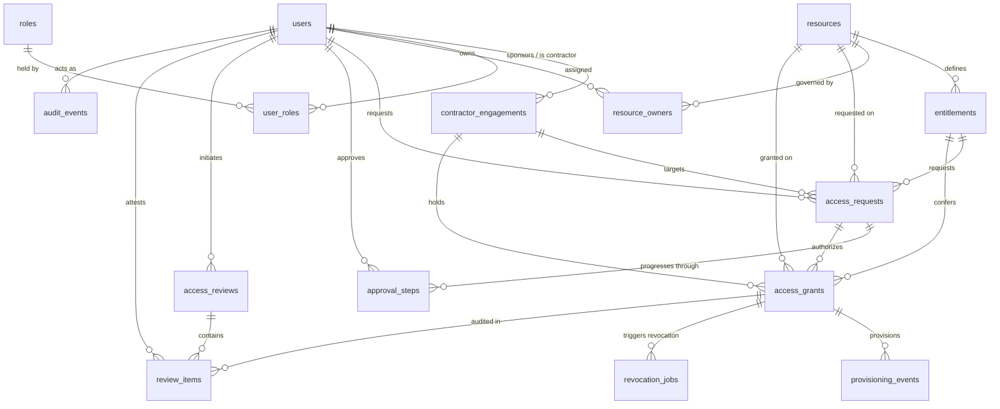

# AccessLease — Entity Relationships & Schema Topology

**Target RDBMS:** Microsoft SQL Server 2019+ / Azure SQL Database  
**Phase:** STEP 01 — Database Design & Schema Migration  
**Document Version:** 1.0.0  

---

## 1. Entity-Relationship (ER) Diagram

The diagram below details the 15 core entities, their primary foreign key linkages, and relational cardinality:

---

## 2. Referential Integrity & Foreign Key Matrix

The table below lists all foreign key definitions, referenced parent entities, delete rules, and business rationales:

| Foreign Key Name | Child Table | Foreign Key Column(s) | Parent Table | Parent PK | Delete Rule | Architectural Rationale |
| :--- | :--- | :--- | :--- | :--- | :--- | :--- |
| `FK_contractor_engagements_contractor` | `contractor_engagements` | `contractor_user_id` | `users` | `user_id` | `NO ACTION` | Contractor user cannot be purged while engagements exist. |
| `FK_contractor_engagements_sponsor` | `contractor_engagements` | `sponsor_user_id` | `users` | `user_id` | `NO ACTION` | Business sponsor cannot be deleted while accountable for contractor. |
| `FK_user_roles_user` | `user_roles` | `user_id` | `users` | `user_id` | `CASCADE` | Removing user account cleanly cascades role assignments. |
| `FK_user_roles_role` | `user_roles` | `role_id` | `roles` | `role_id` | `CASCADE` | Retiring role removes association mapping. |
| `FK_user_roles_assigned_by` | `user_roles` | `assigned_by_user_id` | `users` | `user_id` | `NO ACTION` | Audit attribution preserved. |
| `FK_entitlements_resource` | `entitlements` | `resource_id` | `resources` | `resource_id` | `CASCADE` | Entitlements cannot exist without their parent resource. |
| `FK_resource_owners_resource` | `resource_owners` | `resource_id` | `resources` | `resource_id` | `CASCADE` | Resource ownership mappings deleted if resource decommissioned. |
| `FK_resource_owners_user` | `resource_owners` | `owner_user_id` | `users` | `user_id` | `NO ACTION` | Owner user cannot be dropped while actively owning resources. |
| `FK_access_requests_engagement` | `access_requests` | `contractor_engagement_id`| `contractor_engagements` | `engagement_id` | `NO ACTION` | Requests must preserve historic engagement reference. |
| `FK_access_requests_requested_by`| `access_requests` | `requested_by_user_id` | `users` | `user_id` | `NO ACTION` | Request author identity cannot be orphaned. |
| `FK_access_requests_resource` | `access_requests` | `resource_id` | `resources` | `resource_id` | `NO ACTION` | Resource reference preserved for historical audit. |
| `FK_access_requests_entitlement` | `access_requests` | `entitlement_id` | `entitlements` | `entitlement_id` | `NO ACTION` | Entitlement reference preserved. |
| `FK_approval_steps_request` | `approval_steps` | `request_id` | `access_requests` | `request_id` | `CASCADE` | Approval steps belong strictly to request lifecycle. |
| `FK_approval_steps_approver` | `approval_steps` | `assigned_approver_user_id`| `users` | `user_id` | `NO ACTION` | Approver identity must remain auditable. |
| `FK_access_grants_request` | `access_grants` | `request_id` | `access_requests` | `request_id` | `NO ACTION` | Grant retains permanent link to originating request. |
| `FK_access_grants_engagement` | `access_grants` | `contractor_engagement_id`| `contractor_engagements` | `engagement_id` | `NO ACTION` | Engagement reference cannot be dropped. |
| `FK_access_grants_resource` | `access_grants` | `resource_id` | `resources` | `resource_id` | `NO ACTION` | Resource link preserved. |
| `FK_access_grants_entitlement` | `access_grants` | `entitlement_id` | `entitlements` | `entitlement_id` | `NO ACTION` | Entitlement link preserved. |
| `FK_provisioning_events_grant`| `provisioning_events`| `grant_id` | `access_grants` | `grant_id` | `CASCADE` | Provisioning log cascades if grant test record dropped. |
| `FK_revocation_jobs_grant` | `revocation_jobs` | `grant_id` | `access_grants` | `grant_id` | `CASCADE` | Revocation queue cascades with grant. |
| `FK_access_reviews_initiator` | `access_reviews` | `initiated_by_user_id` | `users` | `user_id` | `NO ACTION` | Review campaign initiator must remain on record. |
| `FK_review_items_review` | `review_items` | `review_id` | `access_reviews` | `review_id` | `CASCADE` | Review line-items cascade with campaign container. |
| `FK_review_items_grant` | `review_items` | `grant_id` | `access_grants` | `grant_id` | `NO ACTION` | Grant evaluated in review cannot be deleted while under review. |
| `FK_review_items_reviewer` | `review_items` | `reviewer_user_id` | `users` | `user_id` | `NO ACTION` | Reviewer identity preserved. |
| `FK_audit_events_actor` | `audit_events` | `actor_user_id` | `users` | `user_id` | `SET NULL` | If historical user identity purged, audit record retains event details while setting actor ID to NULL. |

---

## 3. Critical Dependency Cycles & Resolution

The schema architecture deliberately avoids circular foreign key dependencies:
* `access_grants` depends on `access_requests`, but `access_requests` has **zero** foreign key reference back to `access_grants`.
* `contractor_engagements` references `users`, but `users` has no reference to `contractor_engagements`.
* All migrations can be executed sequentially from `001` through `006` without recursive dependency resolution or temporary constraint disabling.
